# M14-1 Database 전환 리허설 실행 기록

**진행 흐름:** 부하 도구 인증 보완 → 3 RPS 전환·롤백 검증 → 25 RPS Worker 개선·지표 집계 분리 후 재시험 → 50 RPS API 성능 한계 관측·중단 → V2 쓰기 기준 전환 후 ECS 검증 준비

| 구간 | 수행한 내용 | 결과 |
|---|---|---|
| 1차 | 3 RPS에서 GTID 추격·Worker 인계 | 인증 갱신 누락으로 장시간 부하 판정 제외. 적용 이력 미생성 발견 |
| 2차 | 토큰 갱신을 보완하고 90분 부하·Shadow 10% 실행 | 부하 Threshold 통과, 지속 불일치로 승격 보류 |
| 3차 | 재비교 대기 5초→30초, Shadow 확대·V2 Read 10% | 지속 불일치 재발. 최신 목록을 다시 비교하는 판정 한계 확인 |
| 4차 | 최초 불일치 ID 재확인·처리 시각 보완 후 3 RPS·2시간 실행 | V2 읽기·쓰기 전환, 요청 Check 통과, 최종 17개 테이블 일치 |
| V1 롤백 | 별도 3 RPS·30분 부하 중 V1 복귀 | 요청 실패 0, 양방향 미처리 0, 최종 17개 테이블 일치 |
| 25 RPS | 약 5.5만 건 누적 후 기존 Worker 활성화 | 처리 약 30~35 events/s로 유입을 추격하지 못함 |
| 초기 적체량을 맞춘 재시험 | 약 5만 건대 추격 후 Shadow 100%·V2 Read 10% 검증 | 피크 약 1,200 events/s. 이후 주기적 처리 공백·skipped·lagging·로그인 지연 발견. 최종 정합성 미확인 |
| 지표 집계 분리 후 25 RPS 재시험 | 90분 부하·V2 읽기·쓰기 전환·역방향 처리 | HTTP 실패·예정 iteration 누락 0. 추격 후 반영 지연 약 1초. 종료 후 확인한 13개 테이블 데이터 일치 |
| 50 RPS | 정방향 적체 약 5.7만 건 소진 후 API 성능 조사 | API p95 약 1~3초 반복·커넥션 대기 최대 약 125 관측 후 부하 중단. 전체 전환 통과 판정 제외 |

시도별 결과는 본문에 요약하고 실행 과정·수치·사진은 접기 안에 정리했다. 검증 범위는 각 시험의 부하와 비교 대상 데이터로 한정했다.

## 1. 기록 목적과 리허설 시작 조건

Staging에서 DB 전환 절차를 실행하며 확인한 조건·수치·문제·조치 결과를 정리했다. 기준 절차는 `[M14-1] 데이터베이스 무중단 마이그레이션.md`이며, 여기서는 실제로 진행한 순서와 단계별 확인 결과를 기록했다.

이번 리허설은 빈 Database를 새로 만드는 작업이 아니다. 기존 서비스를 제공하는 **V1 Source Database**와 전환 대상인 **V2 Primary Database**가 모두 준비되어 있고, V1의 초기 Dump를 V2에 복원한 상태에서 시작한다. 이후 지속적인 사용자 쓰기를 발생시키면서 초기 Dump 이후의 변경을 GTID와 Outbox Worker로 이어받고, 마지막에는 읽기와 쓰기 경로를 V2로 전환할 수 있는지를 검증한다.

### 리허설 시작 조건

| 구분 | 시작 상태 | 이번 리허설에서 확인할 내용 |
|---|---|---|
| V1 Database | 현재 서비스의 Source이자 초기 Writer | 부하 중에도 요청과 Binary Log·Outbox Event가 계속 생성되는가 |
| V2 Database | 전환 대상 Primary가 별도로 구성됨 | V1의 후속 변경을 받아 동일한 Business Data를 유지하는가 |
| 초기 데이터 | V1 Dump를 V2에 복원했고, Source GTID `1-14`까지 초기 기준에 포함됨 | 초기 기준 이후 GTID를 자동 위치 방식으로 이어받는가 |
| GTID 조건 | 양쪽 모두 GTID와 Row 기반 Binary Log 사용, `server_id`는 서로 다름 | 복제 Thread가 오류 없이 시작하고 지연이 `0`으로 수렴하는가 |
| 전환 제어 | AppConfig로 Writer·Read 비율·Worker 방향을 단계별 변경 | 설정 변경이 실제 애플리케이션과 Dashboard에 반영되는가 |
| Outbox | V1·V2에 Migration Outbox 관련 Table이 준비됨 | GTID 중지 뒤 Worker가 변경 전달을 이어받고 PENDING을 소진하는가 |
| 관측 수단 | k6 부하 시나리오와 Grafana Dashboard 준비 | 요청 성공률·지연·5xx·복제 지연·Worker 상태를 같은 시간대로 확인하는가 |

최초 리허설의 시작 상태는 Writer와 사용자 Read를 모두 V1에 유지하고, GTID 복제와 양방향 Worker, V2 Read, Shadow Read를 아직 실행하지 않은 Baseline이다. 2차 재시도에서는 Database를 다시 초기화하지 않고 기존 복제 채널을 `STOPPED` 상태로 유지한 채 AppConfig만 같은 Baseline으로 되돌린다. 새로 발생하는 요청과 Event를 기준으로 각 전환 단계를 다시 검증한다.

> **검증 목표**
>
> 지속적인 쓰기 부하 아래에서 `Baseline → GTID 추격 → Outbox Worker 인계 → Shadow Read → V2 Read → Writer 전환` 순서를 수행하고, 각 경계에서 사용자 요청 오류와 데이터 누락 없이 다음 단계로 넘어갈 수 있는지를 확인한다. 단계별 사진은 설정값 자체가 아니라 실제 동작 결과와 다음 단계 진입 조건을 함께 증명하는 용도로 사용한다.

<details>
<summary>지표를 읽는 기준</summary>

| 지표 | 이 문서에서의 의미 |
|---|---|
| API RPS / Worker events/s | 사용자 HTTP 요청 수 / 완료한 변경 이벤트 수. 한 요청에서 여러 이벤트가 생기므로 서로 다름 |
| PENDING / Oldest Pending Age | 남은 이벤트 수 / 현재 남은 이벤트 중 가장 오래된 대기 나이 |
| Apply Lag | 완료 이벤트의 생성→반영 지연. API 응답 시간이나 SQL 한 건의 실행 시간이 아님 |
| Shadow 결과 | Dashboard 조회 시간창의 증가량. 화면마다 독립 표본이나 실행 전체 누적값이 아님 |
| ACTIVE / FAILED 0 | Worker 활성화 상태 / 실패 상태 이벤트가 없음. 실제 데이터 일치와는 별개 |

그래프에서 읽은 수치는 근삿값이다. PENDING이 0 부근이라는 화면과 SQL로 확인한 정확한 0건을 구분한다. 최종 정합성 판정에는 별도의 행·컬럼 비교 결과를 사용한다.

</details>

---

## 2. 1차 시도 — 장시간 인증 갱신 누락으로 판정 실패

최초 시도에서는 GTID 추격과 Outbox Worker 인계까지 진행했으나, k6가 `setup()`에서 발급한 Access Token을 60분 동안 갱신하지 않아 시작 약 16분 뒤부터 요청이 실패했다. 따라서 1차 시도의 사진과 실행 내용은 삭제하지 않고 아래 접기 영역에 보존하되, **성공한 지속 부하 아래에서 수행한 최종 리허설 증거로는 사용하지 않는다.**

<details>
<summary><strong>1차 시도 전체 과정·사진·실패 원인 펼쳐보기</strong></summary>

#### 쓰기 중심 k6 시나리오 확인

기존 조회 중심 부하 대신, 새 대화 생성 90%와 대화 목록 조회 10%로 구성한 M14-1 전용 시나리오를 사용했다. 대화 생성 하나가 Conversation과 Message Row를 함께 생성하므로, 리허설 전 구간에서도 지속적인 Database 쓰기와 Outbox Event를 발생시킨다.

| 구분 | 사전 검증 조건 |
| --- | --- |
| 실행 시각 | 2026-10-14 13:22~13:23 KST |
| 대상 | V1 개발서버 Backend |
| 부하 모델 | Open Model, Constant Arrival Rate |
| 부하 | 1 RPS, 1분 |
| VU | 초기 5, 최대 20 |
| 흐름 | 쓰기 90%, 조회 10% |

사전 실행에서 모든 Threshold가 통과했다. Check와 쓰기 성공률은 100%, HTTP 실패와 스케줄된 Iteration 누락은 0건이었고, 전체 HTTP p95는 149.61ms였다.

<p align="center">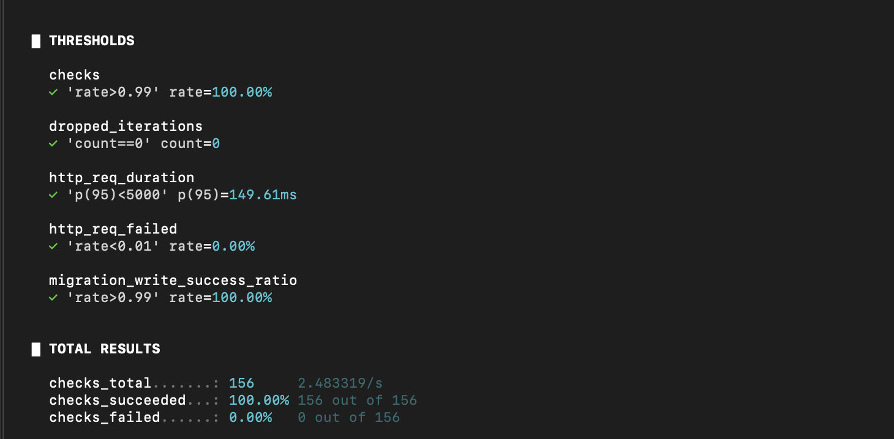</p>

쓰기는 55건 시도해 55건 모두 성공했고, 쓰기 응답 시간 p95는 144.90ms였다. `http_reqs=81`에는 본 부하 61건과 `setup()`에서 수행한 입주민 20명의 로그인이 포함된다.

<p align="center">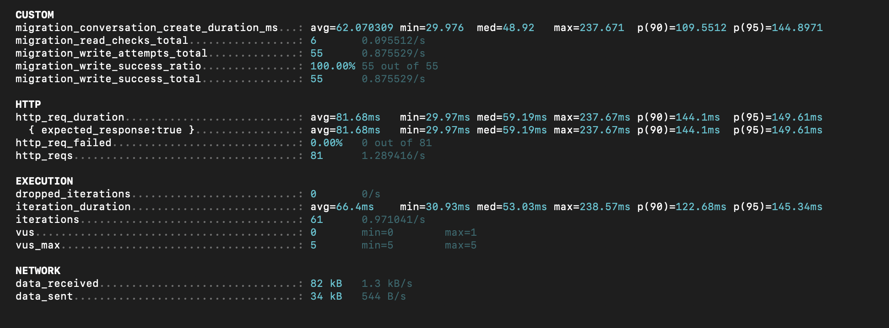</p>

> **판단**
>
> 쓰기 중심 부하를 생성하는 시나리오가 정상적으로 동작했다. 이 결과는 1 RPS에서의 기능 사전 검증이며, 마이그레이션 전체가 성공했다는 의미는 아니다.

#### 전환 전 AppConfig와 Outbox 상태

AppConfig는 Writer를 V1에 유지하고 Worker와 V2 읽기를 끄는 Baseline으로 적용되어 있었다.

| 설정 | 확인값 |
| --- | --- |
| Migration Mode | `V1_PRIMARY` |
| Worker Mode | `PAUSED` |
| V2 Read | `0%` |
| Shadow Read | `0%` |

<p align="center">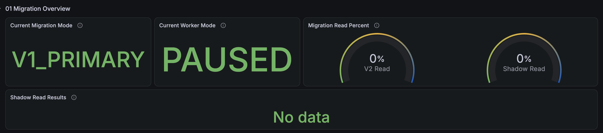</p>

쓰기 시나리오를 실행하면서 `V1_TO_V2` PENDING Event는 약 1.1K건으로 증가했다. Worker를 아직 켜지 않았으므로 양방향은 `INACTIVE`이고, Apply Lag와 Worker Throughput이 `No data`로 나오는 것이 기대한 상태다. FAILED Event는 0건이었다.

<p align="center">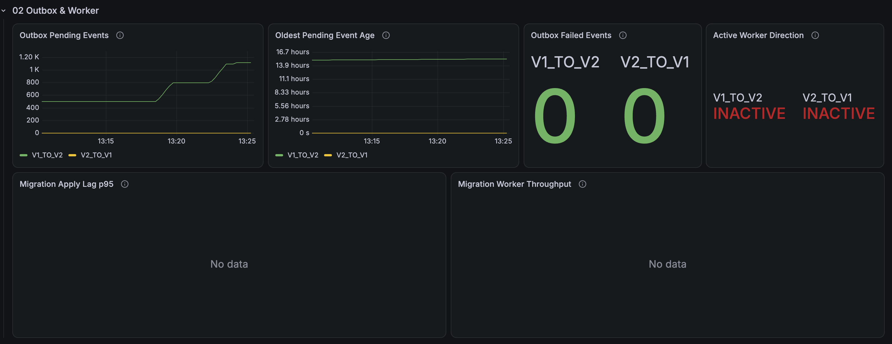</p>

> **판단**
>
> V1 쓰기와 Outbox 생성은 정상적으로 이어졌다. Worker가 PAUSED라 PENDING은 증가했으며, V2 반영은 이후 GTID 연결 단계에서 별도로 확인했다.

#### 부하 시나리오와 초기 설정 점검

| 확인 항목 | 결과 | 판단 |
| --- | --- | --- |
| 쓰기 중심 k6 시나리오 | 모든 Threshold 통과 | 충족 |
| 전환 기준 DB | `V1_PRIMARY` | 충족 |
| Worker | `PAUSED`, 양방향 `INACTIVE` | 충족 |
| V2·Shadow Read | 모두 `0%` | 충족 |
| Outbox 생성 | 쓰기 중 PENDING 증가, FAILED 0 | 충족 |

이후 V1·V2의 GTID·Binary Log 조건을 점검하고 복제를 연결했다.

#### 지속 부하를 적용한 연결 전 Baseline

V1 MySQL은 사설 주소 `10.0.1.124:3306`에만 연결했고, V2 Primary에서 해당 주소로 TCP 연결이 되는 것을 확인했다. 복제 연결 전에는 쓰기 비중 90%의 k6 부하를 먼저 시작하여 실제 요청이 계속 처리되는 조건을 만들었다.

| 항목 | 연결 전 상태 |
|---|---|
| 실행 시각 | `2026-10-14 14:07:40 KST` |
| 부하 모델 | Open Model, `3 RPS`, VU `5~20`, 60분 |
| 요청 구성 | 쓰기 90%, 읽기 10% |
| k6 진행 상태 | 중단된 Iteration `0` |
| Outbox | `V1_TO_V2` PENDING 증가, FAILED `0` |
| Worker | `PAUSED`, 양방향 `INACTIVE` |
| Backend | 약 `3 req/s`, 5xx Error Rate `0%` |

<p align="center">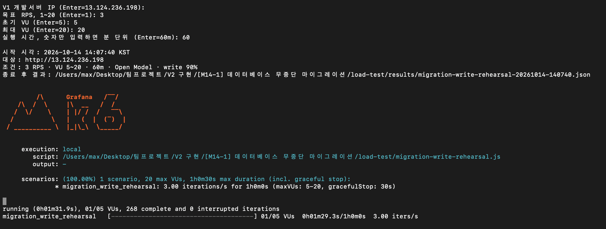</p>

<p align="center">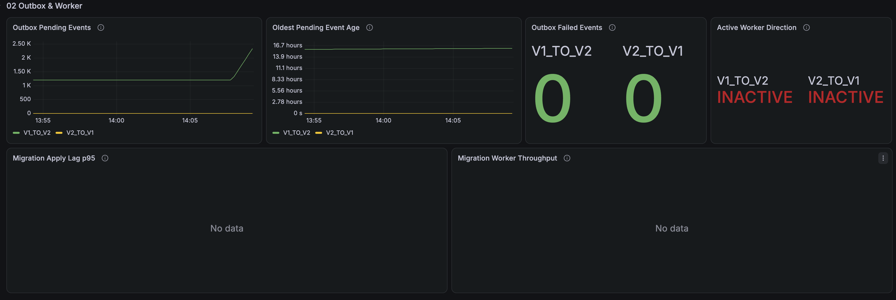</p>

<p align="center">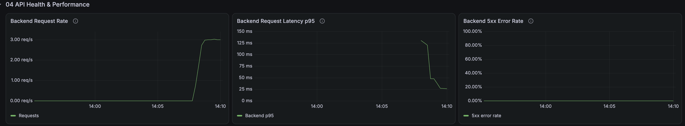</p>

> **구간 1 판단**
>
> 요청과 Outbox 생성이 이어졌고 API 5xx는 없었다. Worker를 정지한 이 상태를 기준으로 GTID 복제 전후를 비교했다.

---

### 1차 시도 — GTID 복제 시작과 추격

3 RPS 부하와 Worker `PAUSED`를 유지한 채 V1·V2의 복제 조건을 확인하고, V2 Primary에 GTID 자동 위치 기반 복제 채널을 연결했다.

#### V1 Source의 GTID 복제 조건

V1 Docker MySQL의 GTID·Binary Log 설정과 현재 GTID 범위를 확인했다.

| 항목 | 확인값 | 판단 |
| --- | --- | --- |
| `server_id` | `1` | V2와 중복 여부 추가 확인 필요 |
| `gtid_mode` | `ON` | 충족 |
| `enforce_gtid_consistency` | `ON` | 충족 |
| `log_bin` | `1` | 충족 |
| `binlog_format` | `ROW` | 충족 |
| `binlog_row_image` | `FULL` | 충족 |
| `gtid_executed` | Source UUID `1-474` | 연결 전 기준값 |
| 기존 Upstream Channel | 없음 | Source 역할과 일치 |

<p align="center">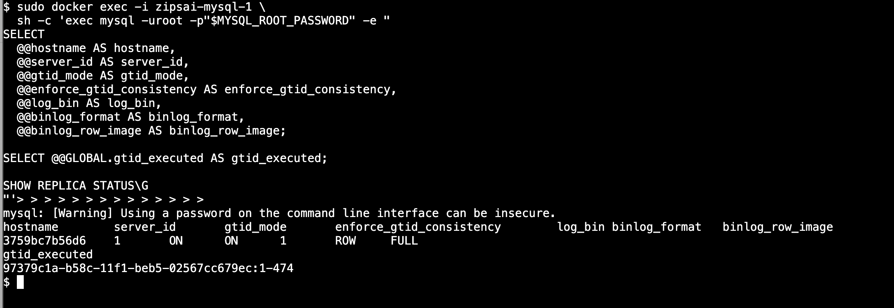</p>

> **판단**
>
> V1의 GTID·Row 기반 Binary Log 생성 조건을 확인했다. V1은 상위 Source로 동작해 `SHOW REPLICA STATUS` 결과가 비어 있었으며, 이어서 V2의 server_id·초기 GTID·복제 채널을 점검했다.

#### V2 Primary의 GTID 수신 조건

V2 Primary에서 GTID와 Binary Log 설정, 쓰기 가능 상태, PK 충돌 방지 설정 및 기존 Replication Channel 여부를 확인하였다.

| 확인 항목 | 결과 | 판단 |
|---|---:|---|
| `server_id` | `101` | V1의 `1`과 중복되지 않음 |
| `gtid_mode` | `ON` | 충족 |
| `enforce_gtid_consistency` | `ON` | 충족 |
| `log_bin` | `1` | 충족 |
| `binlog_format` / `binlog_row_image` | `ROW` / `FULL` | 충족 |
| `read_only` / `super_read_only` | `0` / `0` | V2 Primary 쓰기 가능 |
| `auto_increment_increment` / `offset` | `2` / `2` | V2용 짝수 PK 설정 적용 |
| V1 Source UUID의 실행 범위 | `1-14` | 초기 Dump에 포함된 기준 범위 |
| V2 자체 UUID의 실행 범위 | `1-168` | V2에서 발생한 로컬 트랜잭션 |
| V1 Source UUID의 `gtid_purged` | `1-14` | 초기 이관 기준 GTID로 기록됨 |
| 기존 Upstream Channel | 없음 | 아직 V1 → V2 복제를 연결하지 않은 상태 |

<p align="center">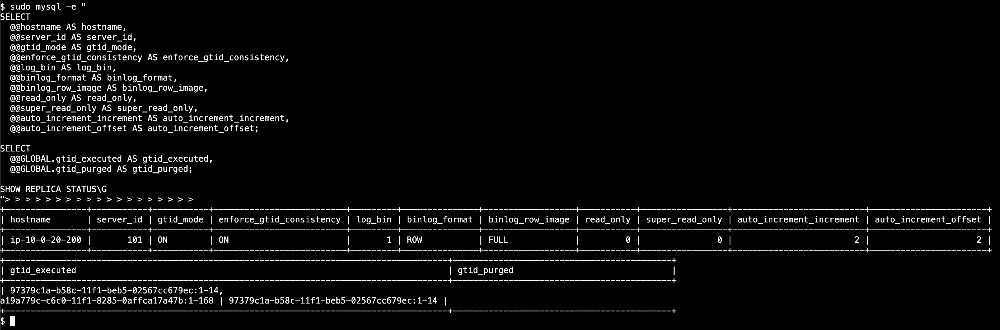</p>

> **판단**
>
> V2 Primary의 GTID 수신 조건과 PK 충돌 방지 설정은 준비되었다. 초기 Dump가 V1 Source GTID `1-14`까지 포함하고 있고, 현재 V1 Source는 `1-474`까지 진행했으므로 복제 연결 시 이어 받아야 할 구간은 `15-474`이다. 다만 연결 전에 V1이 이 누락 구간의 Binary Log를 아직 보관하는지 확인해야 한다. 이 확인 없이 복제를 시작하면 필요한 GTID가 이미 삭제된 경우 추격이 실패할 수 있다.

#### V1 Binary Log 보존 구간 확인

복제 연결 직전 V1 Source의 GTID 삭제 범위와 Binary Log 보존 상태를 확인하였다.

| 확인 항목 | 결과 | 판단 |
|---|---:|---|
| `gtid_executed` | Source UUID `1-474` | 점검 시점 최신 범위 |
| `gtid_purged` | 비어 있음 | 실행한 GTID가 Binary Log에서 삭제되지 않음 |
| `binlog_expire_logs_seconds` | `2,592,000`초 | 보존 기간 30일 |
| Binary Log | `binlog.000001`부터 다수 존재 | V2가 요구하는 후속 구간을 제공할 수 있음 |

<p align="center">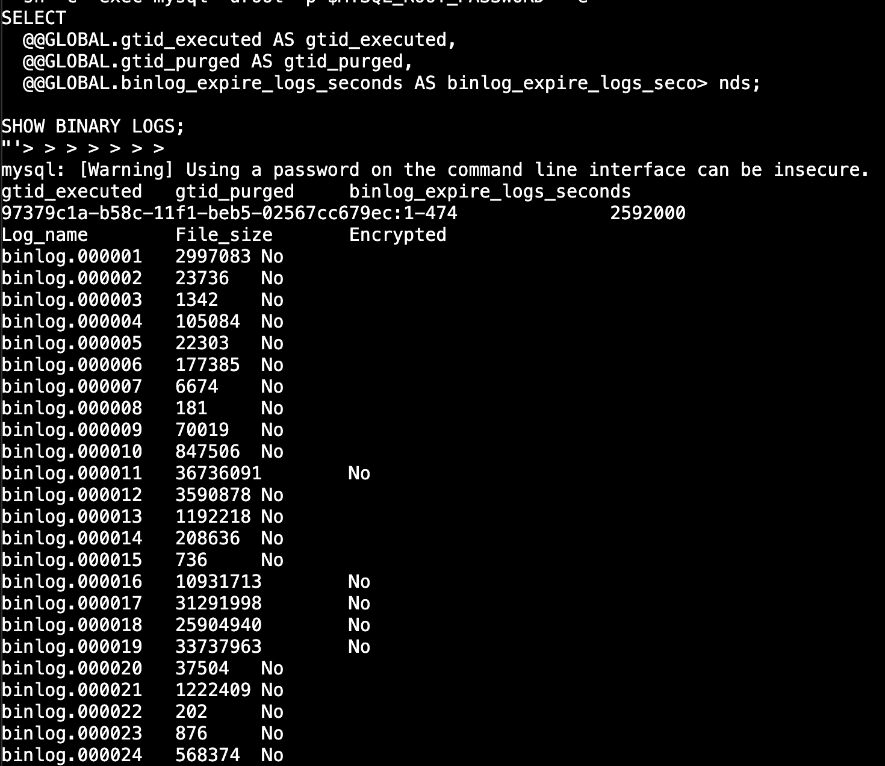</p>

> **판단**
>
> V2의 초기 기준인 Source GTID `1-14` 이후 구간이 V1에서 Purge되지 않았다. 따라서 `SOURCE_AUTO_POSITION=1`로 연결하면 V2는 자신에게 없는 Source GTID부터 자동으로 요청할 수 있다.

#### GTID 복제 시작과 변경 추격

조건 확인 후 GTID 복제 채널을 시작하였다. 여기서 시작한 Replica는 별도의 V2 Replica Instance가 아니라, **V2 Primary가 V1의 변경을 수신하고 적용하기 위한 Replica I/O·SQL Thread**를 뜻한다.

| 확인 항목 | 연결 직후 상태 | 의미 |
|---|---:|---|
| `Replica_IO_Running` | `Yes` | V1의 Binary Log Event를 정상 수신 중 |
| `Replica_SQL_Running` | `Yes` | 수신한 Event를 V2 Primary에 정상 적용 중 |
| `Source_SSL_Allowed` | `Yes` | 복제 연결에 TLS 사용 |
| `Seconds_Behind_Source` | `954`초 | 연결 직후 과거 Event를 추격 중 |
| `Last_IO_Error`, `Last_SQL_Error` | 비어 있음 | 확인 시점 수신·적용 오류 없음 |
| `Auto_Position` | `1` | GTID 자동 위치 기반 복제 사용 |

<p align="center">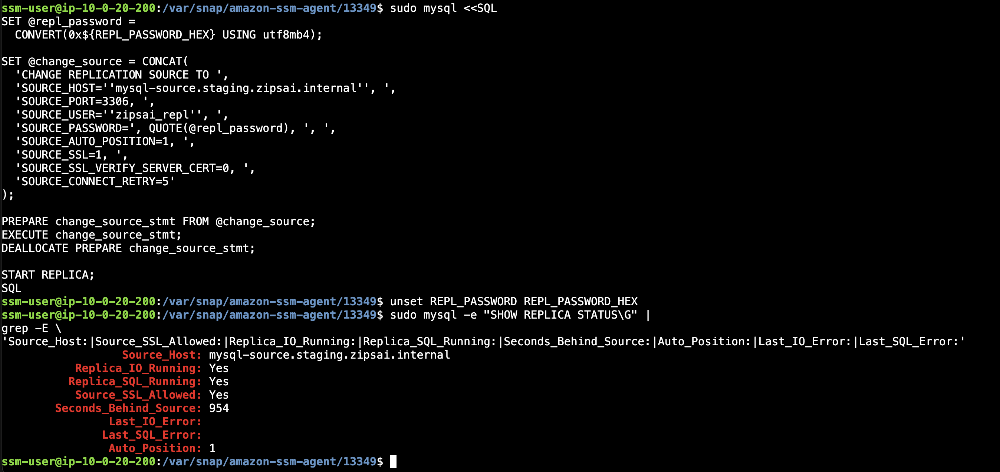</p>

연결 직후 지연은 954초였다. 복제를 유지하며 지연과 두 Thread 상태를 관찰했다.

이후 지연은 `0`으로 수렴했고 I/O·SQL Thread는 모두 `Yes`를 유지했으며 수신·적용 오류도 발생하지 않았다.

<p align="center">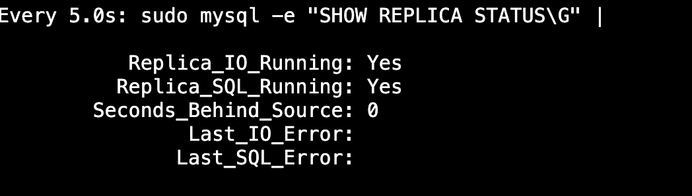</p>

이는 연결 전에 누적된 GTID를 V2 Primary가 모두 따라잡았다는 의미다. 복제 채널 자체는 종료하지 않고 계속 실행되므로, 이후 V1에서 발생하는 새 쓰기도 V2 Primary로 지속적으로 전달된다.

Grafana에서도 같은 구간에 Replication Lag가 약 17분에서 `0`으로 내려갔고, V2 Primary의 I/O·SQL Thread가 모두 `RUNNING`으로 표시되었다. 추격 과정에서 V2 Primary의 Disk Write가 일시적으로 증가했지만, 지연이 해소된 뒤 다시 안정화되었다.

<p align="center">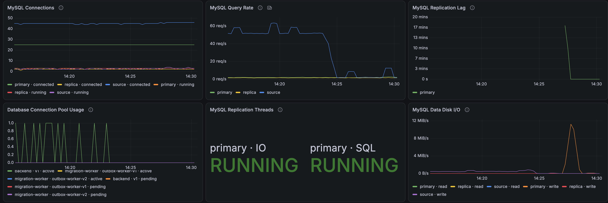</p>

같은 시간에 Outbox의 `V1_TO_V2` PENDING은 증가했지만 FAILED는 `0`이었고 양방향 Worker는 `INACTIVE`를 유지했다. 따라서 이 구간의 V2 데이터 반영은 Outbox Worker가 아니라 GTID 복제에 의해 이루어졌음을 구분할 수 있다.

<p align="center">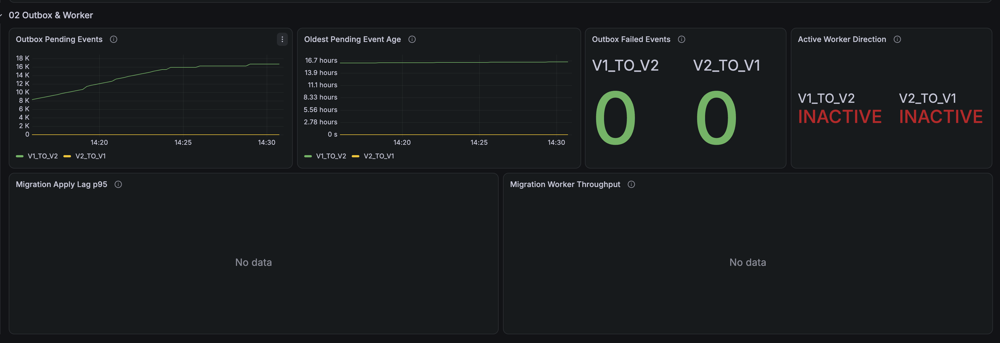</p>

GTID가 과거 Event를 추격하는 동안에도 Backend Request Rate는 약 `3 RPS`를 유지했고, Request Latency p95는 관측 구간에서 약 `33ms` 이하였으며 5xx Error Rate는 `0%`였다.

<p align="center">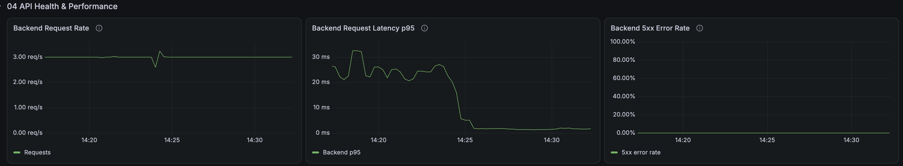</p>

> **구간 2 종합 판단**
>
> GTID 복제는 초기 지연을 해소해 `0`으로 수렴했고, 두 Replication Thread는 계속 실행되었다. 같은 시간에 Worker는 비활성 상태였으며 Backend는 3 RPS의 요청을 처리하면서 5xx를 발생시키지 않았다. 따라서 이번 구간에서는 GTID 초기 추격이 사용자 요청 중단으로 이어지지 않았음을 확인했다.

---

### 1차 시도 — GTID에서 Outbox Worker로 인계

앞 구간에서 GTID 지연이 `0`으로 수렴한 것을 확인했다. 이제 GTID 복제를 중지하고 `V1_TO_V2` Worker가 이후 변경을 이어받는 구간을 검증한다. 인계 전에 Worker가 최초로 처리할 Outbox 백로그를 기준값으로 기록하였다.

| 확인 항목 | 인계 직전 값 | 의미 |
|---|---:|---|
| `V1_TO_V2` `PENDING` | `16,737`건 | Worker가 활성화된 뒤 처리해야 할 최초 백로그 |
| `Migration_applied_events` | `0`건 | 아직 Worker가 실행되지 않아 처리 이력이 생성되지 않은 상태 |

<p align="center">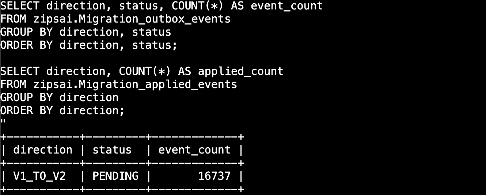</p>

이 값은 Worker 인계 후 PENDING 감소와 처리 이력 증가를 판단하는 시작점으로 사용한다.

#### GTID 복제 채널 중지

V2 Primary에서 GTID 복제 채널을 중지한 직후 상태를 확인하였다.

| 확인 항목 | 결과 | 판단 |
|---|---:|---|
| `Replica_IO_Running` | `No` | V1 Binary Log 수신 중지 |
| `Replica_SQL_Running` | `No` | 수신 Event 적용 중지 |
| `Seconds_Behind_Source` | `NULL` | 채널 중지 상태와 일치 |
| `Last_IO_Error`, `Last_SQL_Error` | 비어 있음 | 오류에 의한 비정상 정지가 아님 |
| `Auto_Position` | `1` | 재연결에 필요한 GTID 자동 위치 설정 유지 |

<p align="center">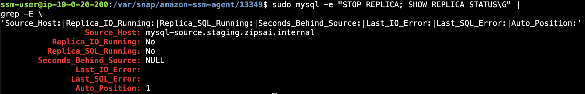</p>

#### Outbox Worker 활성화 설정 배포

GTID 채널 중지 직후 `forward-worker-running-v1` 설정을 배포하였다. 스크립트는 AppConfig Version `3`, Deployment `3`의 시작 요청을 정상적으로 완료했다. 실제 애플리케이션 반영 여부는 이어지는 Dashboard 지표로 검증한다.

<p align="center">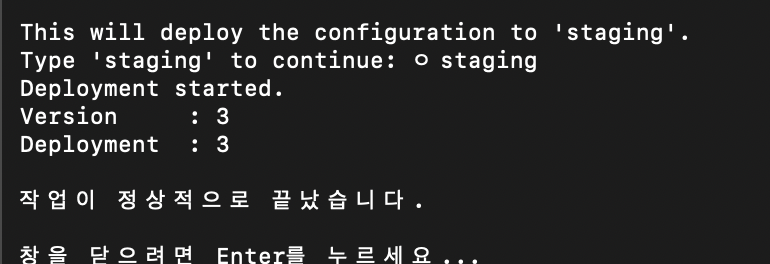</p>

배포한 AppConfig는 Writer와 Read 경로를 V1에 유지하고 정방향 Worker만 활성화하는 설정이다. `mode=V1_PRIMARY`, `v2ReadPercent=0`, `shadowReadPercent=0`을 유지하면서 `workerMode=RUNNING`, `forwardWorkerEnabled=true`로 변경했으며, 역방향 Worker는 아직 비활성화하였다.

<p align="center">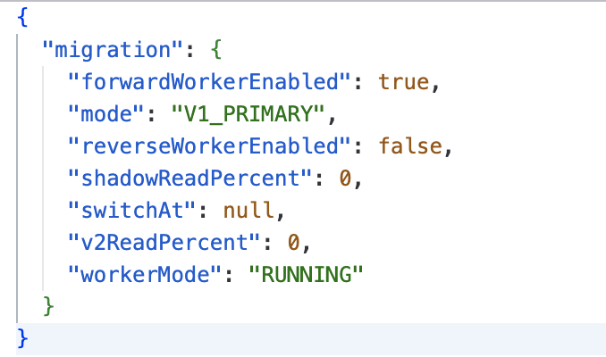</p>

이후 단계에서도 AppConfig 설정 화면과 Dashboard 결과를 함께 기록한다. 설정 화면은 **의도한 전환 값**, Dashboard는 **애플리케이션이 실제로 반영하고 동작한 결과**를 각각 증명한다.

#### GTID에서 Outbox Worker로 변경 전달 인계

AppConfig 반영 후 Migration Mode는 계속 `V1_PRIMARY`를 유지하면서 Worker Mode만 `RUNNING`으로 변경되었다. V2 Read와 Shadow Read는 모두 `0%`이므로, 이번 구간에서는 읽기 경로를 바꾸지 않고 데이터 전달 방식만 GTID에서 Outbox Worker로 인계하였다.

<p align="center">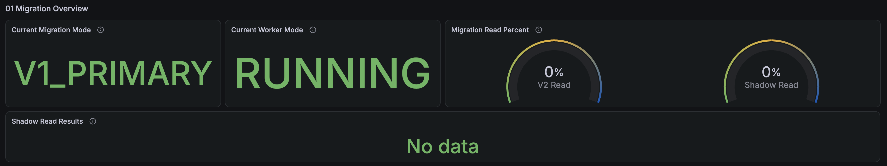</p>

Dashboard에서 `V1_TO_V2` 방향이 `ACTIVE`로 바뀌었고, Worker 처리량은 약 `50 ops/s`까지 증가했다. 인계 직전 약 16.7K건이었던 PENDING은 관측 시점 약 8K건대로 감소했으며, 가장 오래된 PENDING Event의 나이도 급격히 낮아졌다. FAILED Event는 양방향 모두 `0`이었다.

<p align="center">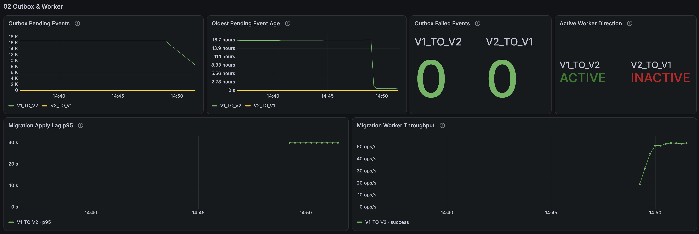</p>

같은 구간에 GTID Replication I/O·SQL Thread는 모두 `STOPPED`를 유지했다. 반면 Worker 활성화 시점부터 Query Rate와 Disk I/O가 증가했으므로, 이후 V2 반영이 중지된 GTID 채널이 아니라 Worker 처리에 의해 진행된 구간임을 구분할 수 있다.

<p align="center">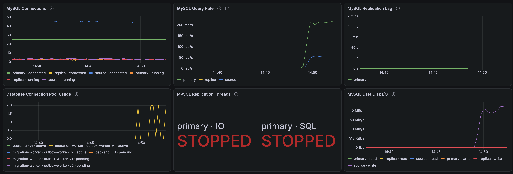</p>

Worker가 백로그를 처리하는 동안에도 Backend Request Rate는 약 `3 RPS`를 유지했다. 관측된 Request Latency p95는 약 `1.3~3.6ms` 범위였고 5xx Error Rate는 `0%`였다.

<p align="center">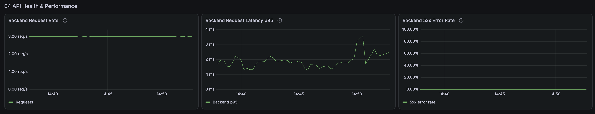</p>

인계 직후에는 잔여 이벤트가 남아 있어, 같은 설정으로 처리를 유지하며 최종 소진을 확인했다.

이후 PENDING은 약 16.7K건에서 `0`까지 감소했고, 가장 오래된 PENDING Event의 나이도 `0초`로 수렴했다. `V1_TO_V2` Worker는 계속 `ACTIVE`였으며 FAILED Event는 `0`을 유지했다.

<p align="center">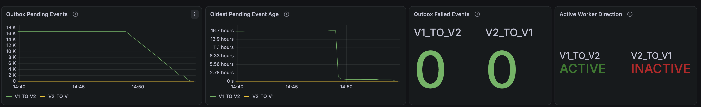</p>

이 화면으로 Worker가 준비된 백로그를 모두 소비한 사실은 확인할 수 있다. 같은 Event의 중복 처리 여부는 `Migration_applied_events`의 전체 Key 수와 고유 Key 수를 별도로 비교해 확인한다.

V2 Primary에서 후속 확인한 결과, V2에 GTID로 복사돼 있던 Outbox Row는 여전히 `16,737 PENDING`으로 남아 있었고 `Migration_applied_events` 조회 결과는 비어 있었다.

<p align="center">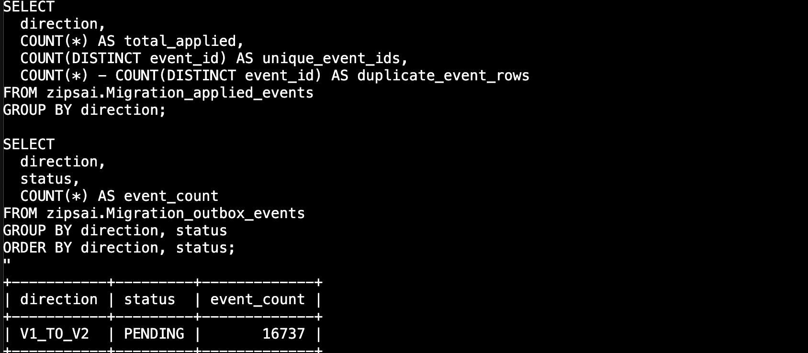</p>

V2 Outbox가 그대로인 것은 GTID 중지 이후 Worker가 원본인 V1 Outbox 상태를 변경하므로 설명할 수 있다. 반면 V2 적용 이력이 비어 있는 결과는 설계 문서의 중복 방지 흐름과 일치하는지 추가 확인이 필요하다. 따라서 Dashboard의 PENDING `0`만으로 Business Row 중복 방지가 검증됐다고 결론내리지 않는다.

V1 Source에서 같은 시점의 원본 Outbox를 확인한 결과 `V1_TO_V2 COMPLETED`가 `16,737건`이었다. 따라서 Dashboard의 PENDING 감소는 실제 V1 Outbox 상태 변경과 일치한다. 그러나 V1에서도 `Migration_applied_events` 조회 결과가 비어 있어, 현재까지 확인한 두 Database 어디에도 Event 처리 이력이 생성되지 않았다.

<p align="center">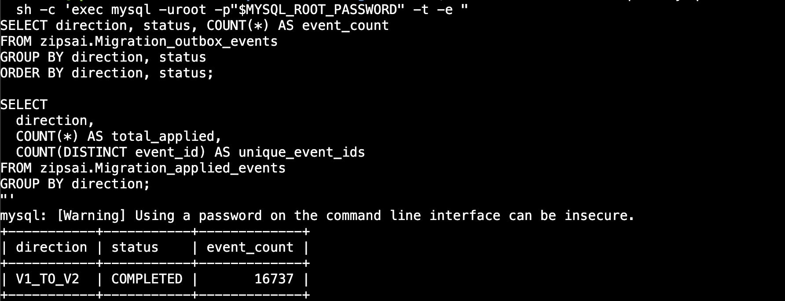</p>

> **리허설 발견사항 — 중복 방지 이력 미생성**
>
> Worker는 16,737건을 성공 처리한 것으로 표시하고 원본 Outbox를 `COMPLETED`로 변경했지만, 설계에서 중복 방지 기준으로 정의한 `Migration_applied_events`에는 이력이 생성되지 않았다. Business Row 중복 여부와 Worker의 실제 처리 경로를 확인하기 전에는 이 구간을 정합성 검증 완료로 판정하지 않는다.

완료 처리된 Event를 Entity와 Operation별로 분해한 결과는 다음과 같다.

| Entity | Operation | Event 수 | 고유 Entity 수 |
|---|---|---:|---:|
| `Conversations` | `INSERT` | 2,696 | 2,696 |
| `Conversations` | `UPDATE` | 8,088 | 2,696 |
| `Messages` | `INSERT` | 5,392 | 5,392 |
| `Refresh_sessions` | `INSERT` | 561 | 561 |

<p align="center">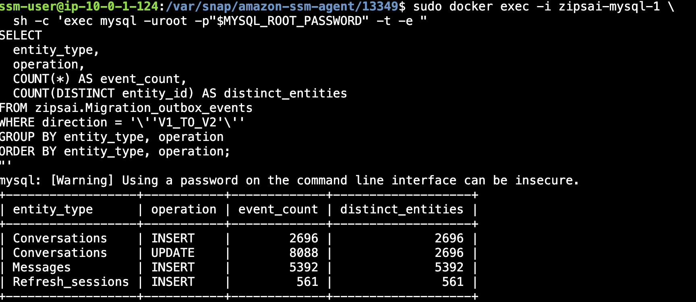</p>

Conversation은 하나의 Entity마다 INSERT 1회와 UPDATE 3회가 기록되었고, Message와 Refresh Session은 INSERT Event가 각각 하나의 고유 Entity에 대응했다. 이후 정합성 검증은 이 세 Business Table을 대상으로 수행한다.

세 Business Table은 각각 Event의 `entity_id`와 대응하는 단일 Primary Key를 가진다.

| Table | Primary Key |
|---|---|
| `Conversations` | `conversation_id` |
| `Messages` | `message_id` |
| `Refresh_sessions` | `session_id` |

<p align="center">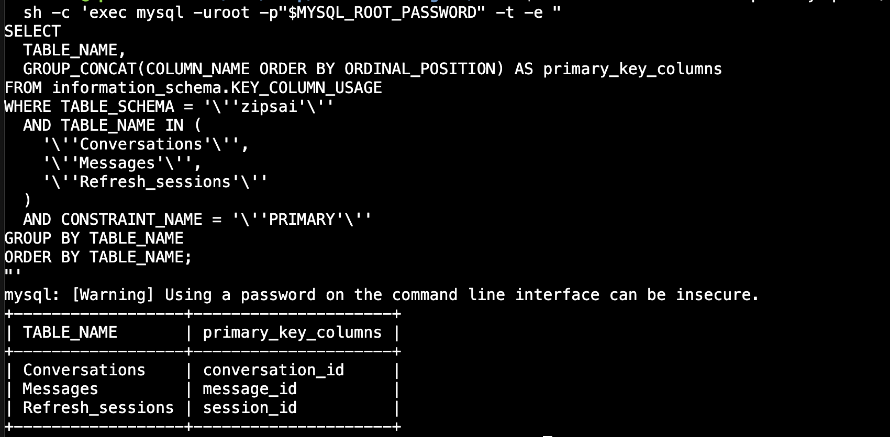</p>

동일한 `entity_id`를 가진 Row가 한 Table 안에서 중복 생성되는 것은 Primary Key가 차단한다. 다만 V2에 모든 대상 Entity가 존재하는지와 Column 값이 같은지는 별도로 확인해야 한다.

V2에 남은 GTID 시점의 Outbox를 기준으로 INSERT 대상 Entity와 실제 Business Row의 존재 여부를 대조하였다.

| Entity | 예상 Entity | V2에서 확인 | 누락 |
|---|---:|---:|---:|
| `Conversations` | 2,696 | 2,696 | 0 |
| `Messages` | 5,392 | 5,392 | 0 |
| `Refresh_sessions` | 561 | 561 | 0 |

<p align="center">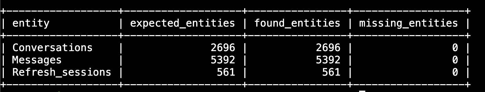</p>

세 Table 모두 Event가 가리킨 고유 Entity가 V2에 빠짐없이 존재했고, 각 Entity ID는 Primary Key로 제한된다. 따라서 이번 인계 대상에서는 Entity 단위 누락과 동일 ID의 중복 Row가 없음을 확인했다. 다만 `Migration_applied_events`가 생성되지 않은 구현 차이는 남아 있으며, Column 값의 동일성은 다음 Shadow Read 구간에서 검증한다.

> **구간 3 판단**
>
> GTID 채널을 중지한 뒤 `V1_TO_V2` Worker가 약 16.7K건의 Outbox 백로그를 `0`까지 소진했고, FAILED Event와 API 5xx는 발생하지 않았다. 또한 세 Business Table의 대상 Entity는 V2에 모두 존재했다. 따라서 데이터 전달 인계와 Entity 존재성은 확인했다. 다만 설계한 Event 처리 이력이 생성되지 않은 문제는 수정이 필요한 구현 차이로 남긴다. Writer 전환 전까지는 Shadow Read로 실제 조회 결과의 동일성을 추가 검증한다.

#### 구간 1~3의 1차 지속 부하 결과

구간 1부터 구간 3까지 유지한 최초 60분 k6 실행은 중단된 Iteration 없이 종료되었고, 전체 HTTP p95도 `66.5ms`였다. 그러나 최종 집계에서 쓰기 성공률은 `26.60%`, HTTP 실패율은 `73.26%`로 Threshold를 통과하지 못했다.

성공한 쓰기 `2,586건`을 실행률 `3 RPS × 쓰기 90%`로 환산하면 약 `958초`, 즉 약 16분에 해당한다. 초기 로그인은 모두 성공했고, 이후 읽기와 쓰기가 비슷한 시점부터 함께 실패했으며, 같은 구간의 Dashboard에서는 Backend 5xx가 `0%`였다. 따라서 이 결과는 Database 처리 한계보다 **`setup()`에서 한 번 발급한 Access Token을 60분 동안 갱신하지 않은 부하 도구의 인증 수명 한계**와 일치하는 패턴으로 판단한다. 다만 1차 스크립트가 응답 Status를 별도 집계하지 않았으므로 `401` 여부를 직접 확인한 사실이 아니라 정황에 기반한 판단이다.

| 1차 실행에서 유효한 관측 | 성능 판정에서 제외하는 관측 |
|---|---|
| GTID 지연 `0` 수렴과 Thread 상태 | 60분 전체 HTTP 성공률 |
| Outbox Worker 백로그 `16,737 → 0` | 60분 전체 쓰기 성공률 |
| 단계별 Dashboard의 5xx `0%`와 지연 추이 | Token 만료 추정 시점 이후의 k6 실패율 |
| Entity 존재성 검증 결과 | 실패 요청이 포함된 전체 평균 처리량 |

이후 스크립트를 수정해 VU별 Access Token을 10분마다 재발급하고, 갱신 성공 횟수와 업무 요청의 `401`·`403` 건수를 별도 지표로 기록했다. 수정 후 결과는 2차 시도에 구분해 기록했다.

---

### 1차 시도 — Shadow Read 설정 직전 상태

앞 구간에서 GTID에서 Outbox Worker로 데이터 전달을 인계하고 대상 Entity의 존재를 확인했다. 이제 사용자 응답은 계속 V1 조회 결과로 제공하면서 일부 요청을 V2에서도 조회하여 실제 응답 데이터의 동일성을 확인한다.

첫 단계에서는 `shadowReadPercent=10`으로 설정한다. Writer와 실제 Read 경로는 계속 V1에 유지하고, 정방향 Worker도 계속 실행한다.

| AppConfig 항목 | 설정값 | 의미 |
|---|---:|---|
| `mode` | `V1_PRIMARY` | Writer는 V1 유지 |
| `workerMode` | `RUNNING` | 정방향 동기화 유지 |
| `forwardWorkerEnabled` | `true` | V1 변경을 V2로 반영 |
| `v2ReadPercent` | `0` | 사용자 응답 Read는 아직 V1 |
| `shadowReadPercent` | `10` | 조회 요청 10%를 V2에서도 비교 |
| `reverseWorkerEnabled` | `false` | 역방향 Worker는 아직 비활성 |
| `switchAt` | `null` | Writer 전환 예약 없음 |

<p align="center">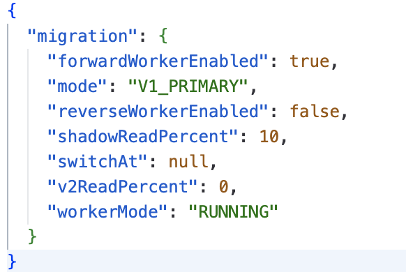</p>

이 사진은 Shadow 10% 설정 증거이며, 정상적인 지속 부하 아래의 비교 결과는 2차 시도에서 다시 확인했다.

> **1차 시도 결론**
>
> GTID와 Worker 자체의 동작 상태는 관측했지만, 장시간 부하의 Access Token이 갱신되지 않아 전환 전 구간에서 성공 요청이 계속됐다고 증명할 수 없었다. 따라서 1차 시도는 최종 무중단 전환 판정에서 제외하고, 원인과 사진만 재현 기록으로 보존한다.

2차 시작 기준은 다음과 같이 정리했다. 실제 적용 결과는 다음 절에 기록했다.

| 복귀 항목 | 2차 시도 시작값 |
|---|---|
| Migration Mode | `V1_PRIMARY` |
| Worker Mode | `PAUSED` |
| Forward / Reverse Worker | 모두 비활성 |
| V2 Read / Shadow Read | 모두 `0%` |
| GTID Mode | 양쪽 모두 `ON` 유지 |
| GTID Replication Thread | `STOPPED` — Baseline 이후 별도로 시작 |
| 사용자 Writer·Read | V1 유지 |

1차의 실패 이력은 보존하고 2차 결과와 구분했다.

</details>

---

## 3. 2차 시도 — 부하 시험 통과 후 Shadow Read 불일치로 승격 보류

1차의 인증 갱신 문제를 수정한 뒤 90분 부하 시험은 모든 Threshold를 통과했다. GTID 추격과 Forward Worker 인계도 확인했지만, Shadow Read 10%에서 대화 목록의 `mismatch_persistent`가 발생해 V2 Read와 Writer 전환은 진행하지 않았다.

<details>
<summary>2차 시도 상세 기록 — 실행 과정·사진·로그·90분 부하 결과</summary>

k6의 10분 주기 토큰 갱신을 적용하고 `V1_PRIMARY`·Worker `PAUSED`·V2/Shadow Read 0%로 시작했다. 3 RPS·쓰기 90%·읽기 10% 부하에서 GTID 추격, Worker 인계, Shadow 비교 순으로 진행했다.

### 2차 시도 Baseline 확인

| 확인 항목 | 관측값 | 판단 |
|---|---:|---|
| Migration Mode | `V1_PRIMARY` | Writer·Read 경로를 V1에 유지 |
| Worker Mode | `PAUSED` | Outbox 전달 중지 |
| V2 Read / Shadow Read | `0%` / `0%` | V2 조회 미사용 |
| Outbox PENDING | `0` | 이전 시도의 백로그 없음 |
| Outbox FAILED | 양방향 `0` | Baseline 오류 없음 |
| Active Worker Direction | 양방향 `INACTIVE` | Worker 정지 상태와 일치 |
| Worker Throughput | `0 ops/s` | 실제 처리도 발생하지 않음 |

<p align="center">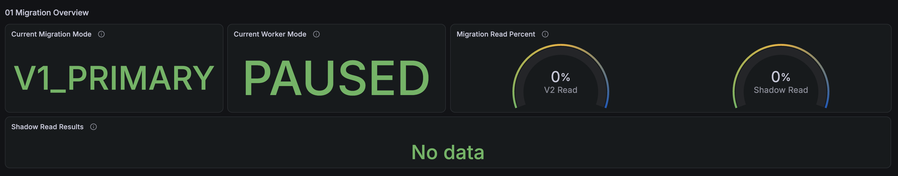</p>

<p align="center">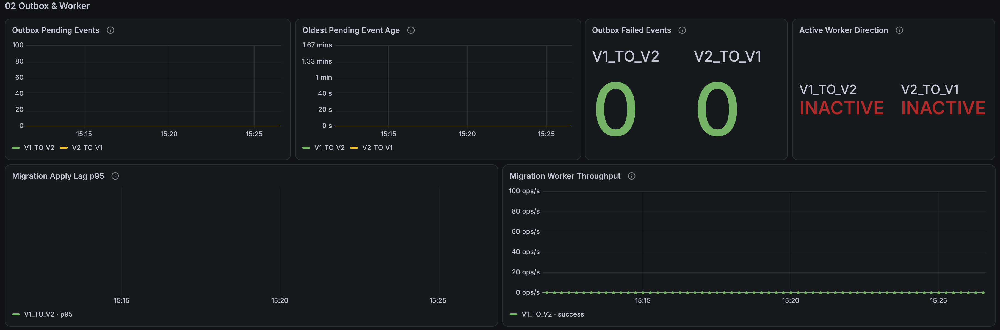</p>

AppConfig와 Outbox·Worker가 시작 기준으로 복귀한 것을 확인하고 수정한 부하를 시작했다.

### GTID 복제 전 쓰기 부하와 Event 누적

수정한 k6를 `3 RPS`, 초기 VU `5`, 최대 VU `20`, 90분 조건으로 시작하였다. Worker와 GTID 복제 채널을 정지한 상태에서 `V1_TO_V2` PENDING은 약 `1.7K`까지 증가했고, 가장 오래된 Event의 나이도 약 2분까지 함께 증가했다.

<p align="center">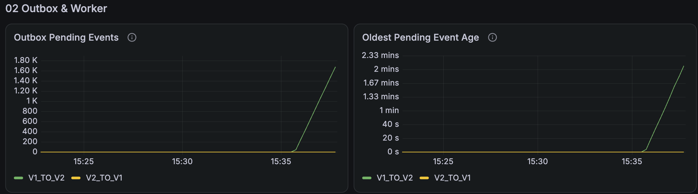</p>

이는 V1 쓰기와 Outbox 기록이 계속 발생하지만 아직 V2로 변경을 전달하는 주체는 없는 Baseline과 일치한다. 같은 시점의 API 요청률·p95·5xx 상태와 V2 Primary의 정지된 Replication Thread를 함께 확인한 뒤, k6를 유지한 채 GTID 복제 채널을 시작한다.

같은 시점에 Backend Request Rate는 목표값인 약 `3 req/s`를 유지했고, 초기 안정화 뒤 Latency p95는 약 `25ms`였으며 5xx Error Rate는 `0%`였다.

<p align="center">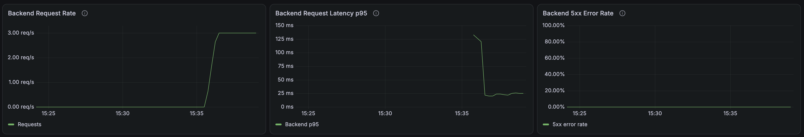</p>

V2 Primary의 Replication I/O·SQL Thread는 모두 `No`, 지연은 `NULL`이었고 마지막 I/O·SQL 오류는 비어 있었다. `Auto_Position=1`은 채널을 시작하면 V2에 없는 GTID부터 자동으로 요청하도록 설정되어 있음을 뜻한다.

<p align="center">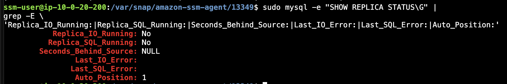</p>

V1 요청과 Outbox 누적, Worker·복제 채널 정지 상태를 확인한 뒤 부하를 유지하며 복제 채널을 시작했다.

### GTID 복제 추격 결과

복제 채널을 시작한 뒤 V2 Primary의 I/O·SQL Thread는 모두 `Yes`가 되었고, `Seconds_Behind_Source`는 `0`으로 수렴했다. 마지막 I/O·SQL 오류는 비어 있었으며 `Auto_Position=1`도 유지됐다.

<p align="center">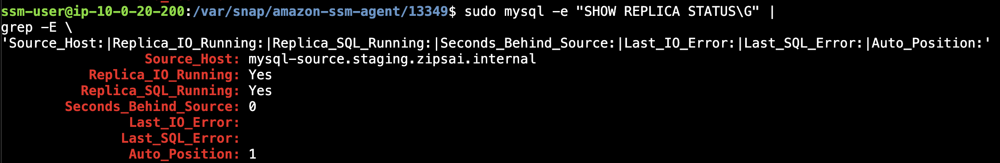</p>

이는 V2가 확인 시점까지 V1에서 생성된 GTID를 모두 적용했다는 의미다. 복제 채널과 k6를 계속 실행하면서 Dashboard에서 지연 `0`, Worker 비활성, API 정상 상태가 함께 유지되는지 확인한다.

Dashboard에서도 Replication Lag는 약 50분에서 `0`으로 수렴했고, V2 Primary의 I/O·SQL Thread는 모두 `RUNNING`이었다. 추격 시점에 V2 Primary의 Disk Write가 일시적으로 약 `13 MiB/s`까지 증가했지만, 지연 해소 뒤 빠르게 낮아졌다. V1 Source의 Query Rate는 부하 구간 동안 약 `50 req/s` 수준을 유지했다.

<p align="center">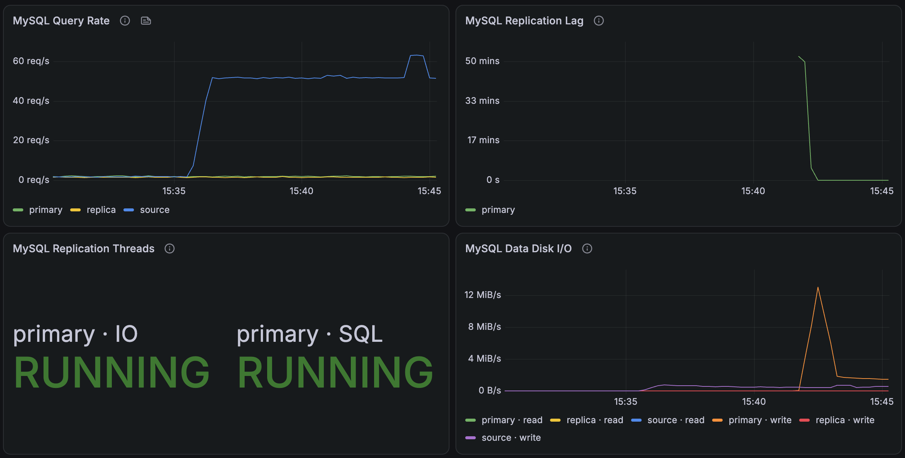</p>

이 네 지표는 같은 시간축을 사용하므로, 복제 Thread 시작과 Lag 해소, 추격 시점의 I/O 변화가 시간상 함께 발생했음을 확인할 수 있다. Disk Write 증가는 추격 동작과 일치하는 관측이며, 이것만으로 병목이라고 판단하지 않는다.

GTID 복제가 실행되는 동안에도 Outbox Worker는 양방향 모두 `INACTIVE`였고 FAILED Event는 `0`이었다. `V1_TO_V2` PENDING은 약 `9K`, 가장 오래된 Event 나이는 약 10분까지 계속 증가했다. 따라서 이 구간에서 V2에 변경을 전달한 주체는 Outbox Worker가 아니라 GTID 복제임을 구분할 수 있다.

<p align="center">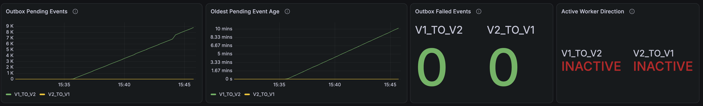</p>

같은 시간에 Backend는 목표값인 약 `3 req/s`를 계속 처리했고, Latency p95는 대부분 약 `20~30ms`, 5xx Error Rate는 `0%`를 유지했다. 이는 10분 Token 갱신 시점 이후에도 성공한 요청과 Outbox 생성이 계속됐다는 Dashboard 근거다. Token 갱신 횟수와 `401`·`403` 발생 여부는 k6 종료 결과에서 최종 확인한다.

<p align="center">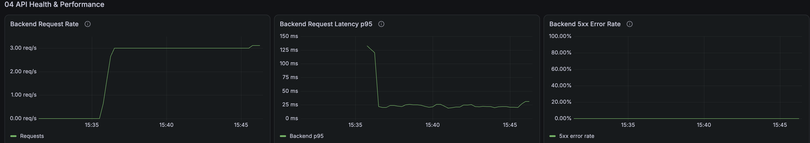</p>

> **GTID 구간 판단**
>
> GTID 복제는 누적 지연을 `0`으로 해소했고 두 Thread는 정상 실행됐다. 이 과정에서 Worker는 개입하지 않았으며, 10분이 지난 뒤에도 사용자 요청률과 낮은 p95, 5xx `0%`가 유지됐다. 다음으로 GTID 복제를 중지하고 Forward Worker가 이후 변경 전달을 이어받는지 검증한다.

### Worker 인계 전 Outbox 기준량

인계 직전 V1 Source의 Outbox를 조회한 결과, 1차 시도에서 완료된 기존 Event는 `16,737건`이고 2차 시도에서 새로 누적된 `V1_TO_V2` PENDING은 `11,089건`이었다.

<p align="center">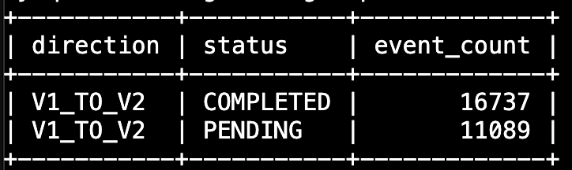</p>

`11,089건`은 조회 시점의 기준값이다. k6 쓰기가 계속되므로 Worker 활성화 전까지 PENDING은 조금 더 증가할 수 있으며, 실제 인계 성공 여부는 Worker 활성화 뒤 관측된 최고점에서 `0`으로 수렴하는지로 판단한다.

### GTID 중지와 Forward Worker 설정 배포

V2 Primary에서 GTID 복제 채널을 중지한 결과 I/O·SQL Thread가 모두 `No`로 전환되었고, 마지막 I/O·SQL 오류는 비어 있었다. `Seconds_Behind_Source=NULL`은 복제 중지 상태의 표시이며 오류를 뜻하지 않는다. `Auto_Position=1`은 유지되므로 필요하면 같은 채널을 다시 시작할 수 있다.

<p align="center">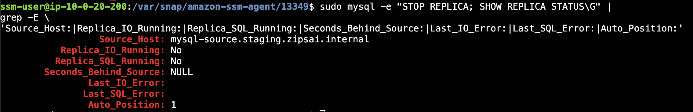</p>

이어 AppConfig의 Forward Worker 실행 설정을 배포했다. 화면의 `Version 3`, `Deployment 5`와 오류 없는 `Deployment started`는 배포 요청이 정상 접수되었음을 보여준다. 다만 이 시점은 설정 전파 및 Worker 활성화가 완료되었다는 증거는 아니므로, 실제 인계 성공은 Dashboard의 Worker 상태와 PENDING 감소로 확인한다.

<p align="center">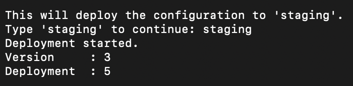</p>

### Forward Worker 백로그 소진

AppConfig 전파 후 Migration Mode는 `V1_PRIMARY`, Worker Mode는 `RUNNING`으로 표시되었고 V2 Read와 Shadow Read는 아직 모두 `0%`였다. 따라서 읽기 경로를 바꾸지 않은 상태에서 Forward Worker만 활성화되었다.

<p align="center">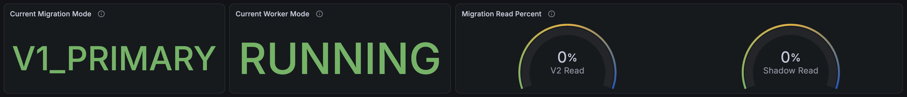</p>

Worker 활성화 직전까지 PENDING은 약 `13.5K`, 가장 오래된 Event age는 약 14분까지 증가했다. 활성화 후 처리량은 최고 약 `55 ops/s`까지 상승했고, PENDING과 가장 오래된 Event 나이는 함께 `0`으로 수렴했다. `V1_TO_V2`는 `ACTIVE`, 반대 방향은 `INACTIVE`, 양방향 FAILED는 모두 `0`이었다.

<p align="center">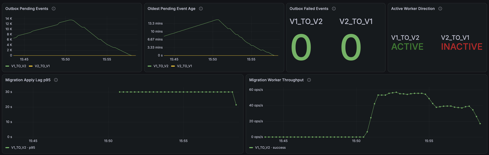</p>

GTID 중지 후 Forward Worker가 신규 유입과 기존 백로그를 처리해 PENDING을 0으로 낮췄고 FAILED는 발생하지 않았다.

같은 인계 구간에서 Backend 요청률은 약 `3 RPS`로 유지되었고 p95는 대체로 `20~30ms`, 5xx 오류율은 `0%`였다.

<p align="center">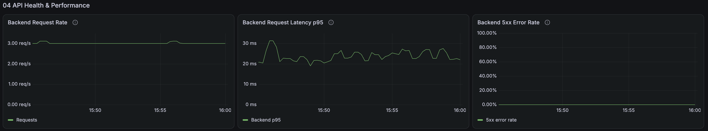</p>

> **인계 구간 결론**
>
> GTID 복제 중지와 Forward Worker의 백로그 소진 동안 요청률 단절, p95 급증, 5xx 오류는 관측되지 않았다. 따라서 데이터 전달 주체 변경은 현재 `3 RPS` 조건에서 사용자 요청을 중단시키지 않았다. 이제 V1 응답은 그대로 유지하면서 Shadow Read 비율을 먼저 `10%`로 올려 V1·V2 조회 결과를 비교한다.

### Shadow Read 10% 설정과 비교 결과

AppConfig의 `shadow-read-10-v1` Action을 사용하여 아래 설정을 배포했다. 이 단계에서는 Forward Worker를 계속 실행하되 실제 사용자 응답은 전부 V1에서 제공하고, 조회 요청 중 10%만 V2 결과와 비교한다.

```json
{
  "migration": {
    "forwardWorkerEnabled": true,
    "mode": "V1_PRIMARY",
    "reverseWorkerEnabled": false,
    "shadowReadPercent": 10,
    "switchAt": null,
    "v2ReadPercent": 0,
    "workerMode": "RUNNING"
  }
}
```

Dashboard에서 `V1_PRIMARY`, Worker `RUNNING`, V2 Read `0%`, Shadow Read `10%`가 반영되었다. 초기 표본에서는 `match=2`, `mismatch_initial=0`, `mismatch_persistent=0`으로 확인되었다.

<p align="center">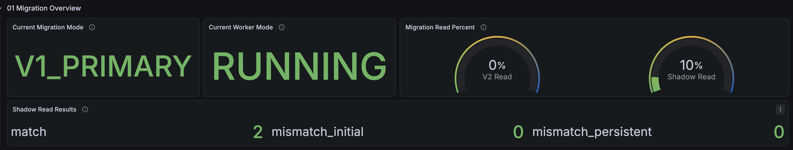</p>

초기 두 건으로 결론 내리지 않고 부하를 유지하며 표본을 늘렸다.

비교 표본이 `match=5`까지 누적된 시점에 `mismatch_initial=1`, `mismatch_persistent=1`이 발생했다.

<p align="center">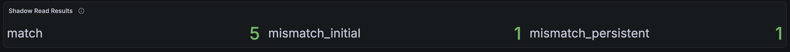</p>

`mismatch_persistent=1`은 최초 불일치가 재확인 뒤에도 해소되지 않았음을 의미하므로 V2 조회 승격 조건을 충족하지 못한다. 실제 사용자 응답은 여전히 V1에서 제공되어 사용자 영향은 없지만, 원인을 확인하기 전에는 Shadow Read 100%와 V2 Read 단계로 진행하지 않는다.

CloudWatch Logs의 `/zipsai/load-test/backend`에서 해당 시간대를 확인한 결과 `16:04:12.555`, `16:05:59.191 KST`에 각각 아래 WARN이 기록되어 있었다.

```json
{
  "event": "shadow_read_mismatch",
  "method": "ConversationService.getConversations(..)",
  "outcome": "mismatch_persistent"
}
```

따라서 한 번의 최초 비교와 재시도 Log가 아니라, 대화 목록 조회에서 최소 두 번의 persistent mismatch가 발생한 사실을 확인했다.

당시 확인한 BE `8895f798`의 `ShadowReadAspect.RECOMPARE_DELAY`는 5초였다. 최초 불일치 후 한 번 재조회해 여전히 다르면 persistent 지표와 WARN을 기록하며, Worker를 중지하지는 않았다. 당시 실행 이미지와 해당 커밋의 일치 여부는 확인하지 않았다.

<details>
<summary>Shadow 판정과 별개인 Worker 실패 처리</summary>

Outbox 적용 예외는 10초 간격으로 재시도하며 다섯 번째 실패에 FAILED로 전환해 뒤 이벤트 처리를 막는다. 재개 조건은 원인 수정 후 해당 이벤트를 PENDING·retry_count 0·다음 재시도 시각 NULL로 되돌리는 것이다. 단순 대기 지연은 이 실패 횟수를 늘리지 않는다.

</details>

쓰기 90% 부하와 Forward Worker가 동시에 실행되는 동안 Apply Lag p95가 약 12초까지 올라갔다. 5초 뒤 재비교가 반영 완료보다 빨랐을 가능성을 가설로 두고, 대기를 30초로 늘려 3차에서 다시 시험했다. 2차 결과만으로 지연이 불일치의 원인이라고 확정하지는 않았다.

> **2차 결과**
>
> 부하 시험은 통과했지만 Shadow의 지속 불일치로 승격을 보류했다. Shadow를 0%로 되돌리고 Forward Worker는 유지했다. 재비교 대기를 30초로 늘린 후 3차에서 다시 검증했다.

### Shadow Read 중단과 안전 상태 복귀

진행 중이던 AppConfig 배포의 완료를 기다린 뒤 `forward-worker-running-v1`을 Version `3`, Deployment `7`로 다시 배포했다. Dashboard에서 `V1_PRIMARY`, Worker `RUNNING`, V2 Read `0%`, Shadow Read `0%`가 확인되어 실제 V2 조회를 사용하지 않는 안전 상태로 복귀했다.

<p align="center">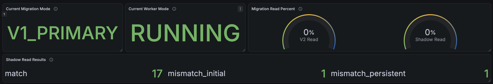</p>

Shadow Read 중단 직후에는 `match=17`, `mismatch_initial=1`, `mismatch_persistent=1`이 표시되었으나 시간이 지나면서 `match=15`, 두 mismatch는 모두 `0`으로 감소했다. 따라서 이 Panel은 전체 누적값을 그대로 표시하는 것이 아니라 최근 조회 구간의 증가량을 계산하며, 과거 Event가 시간창 밖으로 빠지면 값도 감소한다. 별도의 Metric 초기화나 Backend 재시작은 필요하지 않다.

<p align="center">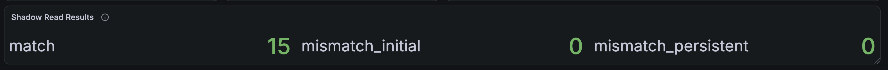</p>

현재 구간의 mismatch가 `0`이라는 사실은 신규 불일치가 없음을 뜻하지만, 앞서 실제로 관측된 persistent mismatch 1건이 해소되었다는 뜻은 아니다. 해당 이력은 원인 확인 또는 깨끗한 재검증 전까지 승격 보류 근거로 유지한다.

같은 시점의 Outbox PENDING은 간헐적으로 약 `320건`, 가장 오래된 Event 나이는 최대 약 `8초`까지 상승했지만 곧 거의 `0`으로 복귀했다. Forward Worker 처리량은 약 `13~25 ops/s`로 계속 발생했고 FAILED는 `0`, `V1_TO_V2` 방향은 `ACTIVE`였다.

<p align="center">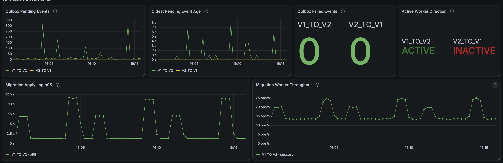</p>

따라서 이 파형은 계속 증가하는 적체가 아니라 유입된 Event를 Batch로 소비하면서 생기는 짧은 변동이다. Migration Apply Lag p95는 주기적으로 약 `12초`까지 상승했으므로 관측값으로 남기되, 현재는 PENDING과 Oldest Age가 반복해서 해소되고 실패도 없어 Worker 포화로 판단하지 않는다.

### 2차 시도 90분 부하 결과

수정한 k6는 `3 iterations/s`, 쓰기 90%·읽기 10% 조건으로 90분을 완료했고 모든 Threshold를 통과했다. 인증 갱신 문제는 재발하지 않았으나 Shadow Read의 지속 불일치가 발생했으므로 전체 전환 성공으로 판정하지 않는다.

| 항목 | 최종 결과 |
|---|---:|
| 업무 Iteration | 16,200 |
| 쓰기 성공 | 14,580 / 14,580 (100%) |
| 조회 Check | 1,620 |
| HTTP 실패 | 0 / 16,260 |
| HTTP p95 | 94.42ms |
| 대화 생성 p95 | 90.86ms |
| Token 갱신 성공 | 40 |
| 인증 거절 / Dropped Iteration | 0 / 0 |

</details>

---

## 4. 3차 시도 — V2 Read 10% 적용 이후 지속 불일치로 승격 보류

재비교 대기를 30초로 늘렸지만 V2 Read 10% 구간에서 지속 불일치가 관측돼 승격을 보류했다. 부하 종료 후 비교 필드는 일치했으며, 조사 결과 최초 불일치 ID 대신 최신 목록을 다시 비교하는 판정 방식의 한계를 확인했다.

<details>
<summary>3차 시도 상세 기록 — 실행 과정·사진·불일치 로그·필드 비교 결과</summary>

재측정 시간을 30초로 변경한 뒤 GTID 추격과 Worker 인계, Shadow Read 10%·100%의 초기 확인 구간까지 진행했다. 이후 실제 V2 Read를 10%로 적용한 상태에서 대화 목록의 `mismatch_persistent`가 관측돼 더 높은 읽기 비율과 Writer 전환으로 진행하지 않았다. 발생 순서는 확인됐지만 읽기 비율 변경 자체를 원인으로 확정하지 않는다.

부하를 중단하고 Worker가 따라잡은 뒤에는 Conversations 72,268행의 비교 대상 8개 필드가 V1·V2에서 모두 일치했다. 이후 상세 로그와 BE 코드 확인으로, 기존 재비교가 최초 불일치 ID를 추적하지 않고 최신 목록을 새로 비교한다는 한계를 확인했다. 다만 이를 모든 불일치의 원인으로 확정하거나 최종 데이터 유실이 없었다는 증명으로 확대하지 않는다.

Backend와 Migration Worker를 모두 `1812cde`로 교체하고 실행 상태를 확인했다. Baseline에서 새 부하를 시작해 전달 인계와 읽기 비교를 다시 검증했다. 아래에는 실행 순서와 불일치 조사 결과를 정리했다.

### 3차 시도 Baseline

부하 시작 전 Dashboard에서 Writer와 사용자 Read는 V1에 유지되고, Worker와 V2·Shadow Read는 비활성 상태임을 확인했다. 이전 실행의 PENDING 약 5.4K건은 시작값으로 남아 있으므로, 이번 시험에서는 0에서 증가하는지 대신 시작값 대비 신규 Event 증가와 이후 백로그 소진을 확인한다.

| 항목 | 확인한 3차 시작 상태 |
|---|---|
| Migration Mode | `V1_PRIMARY` |
| Worker Mode | `PAUSED` |
| Active Worker Direction | 양방향 `INACTIVE` |
| V2 Read / Shadow Read | 모두 `0%` |
| Outbox PENDING | `V1_TO_V2` 약 `5.4K`, 반대 방향 `0` |
| Outbox FAILED | 양방향 `0` |
| GTID Mode | `ON` 유지 |
| GTID Replication Thread | I/O·SQL 모두 `STOPPED` |
| Backend / Worker 이미지 | 모두 `1812cde`, Container `running` |

<p align="center"></p>

Shadow Read는 아직 수행하지 않았으므로 결과 Panel의 `No data`는 이 단계에서 기대한 표시다. Oldest Pending Age에는 이전 실행의 대기 시간이 포함되므로 이번 신규 요청의 지연으로 해석하지 않는다.

### GTID 복제 전 부하 시작

Baseline 상태에서 k6를 `3 iterations/s`, 초기 VU `5`·최대 VU `20`, 쓰기 90%·읽기 10%, 실행 목표 `120분`으로 시작했다. Access Token은 10분마다 갱신하는 수정 스크립트를 사용한다. 최종 Threshold와 성공률은 실행 종료 후 확인한다.

GTID와 Worker가 정지된 구간에서 `V1_TO_V2` PENDING은 시작값 약 `5.4K`에서 약 `6.5K`로 증가했다. 양방향 Worker는 `INACTIVE`, FAILED는 모두 `0`을 유지했다. 따라서 복제 채널을 열기 전부터 V1 쓰기에 따른 Outbox Event가 누적되는 것을 확인했다.

<p align="center"></p>

같은 시간대 Backend 요청률은 약 `3 RPS`까지 상승했고, 시작 직후 p95 약 `130ms`에서 최근 약 `25ms`로 낮아졌으며 5xx Error Rate는 `0%`였다. 이는 부하 시작 구간의 전체 Backend 상태이며, 전체 실행 성공률은 아직 판정하지 않는다.

<p align="center"></p>

### 지속 부하 중 GTID 추격

V2 Primary에서 기존 GTID 채널을 시작하고 상태를 조회한 결과 아래 값이 확인되었다. 추가 터미널 사진 대신 이번 실행의 조회 결과를 텍스트 증거로 기록한다.

```text
Replica_IO_Running: Yes
Replica_SQL_Running: Yes
Seconds_Behind_Source: 0
Last_IO_Error:
Last_SQL_Error:
Auto_Position: 1
```

따라서 사용자 부하가 계속되는 상태에서 GTID 자동 위치 복제가 정상 실행되고, 조회 시점에 지연이 0으로 수렴했음을 확인했다. Worker는 이 구간에서 계속 PAUSED로 유지했다.

### Forward Worker 인계와 백로그 소진

GTID 복제를 중지한 뒤 AppConfig로 Forward Worker 활성화 설정을 배포하기 시작했다.

설정 반영 후 Dashboard에서 `V1_PRIMARY`, Worker `RUNNING`, V2 Read와 Shadow Read 모두 `0%`가 확인되었다. 사용자 읽기와 쓰기 경로는 V1에 유지하면서 변경 전달을 Forward Worker로 인계했다.

<p align="center"></p>

Worker 활성화 전까지 `V1_TO_V2` PENDING은 최고 약 `8.6K`까지 누적됐고, 이후 지속 부하 중에도 `0` 부근으로 소진됐다. 이전 실행의 대기 시간이 포함된 Oldest Pending Age도 약 1.4시간대에서 `0` 부근으로 낮아졌다. 정방향은 `ACTIVE`, 반대 방향은 `INACTIVE`였고 양방향 FAILED는 모두 `0`이었다.

<p align="center"></p>

같은 구간 Backend 요청률은 약 `3 RPS`를 유지했고, 부하 시작 직후를 제외한 최근 p95는 약 `25~30ms`, 5xx Error Rate는 `0%`였다. 백로그 소진 구간에서 요청률 단절이나 지연 급증은 관측되지 않았다.

<p align="center"></p>

> **인계 구간 판단**
>
> 3 RPS 부하에서 Worker 활성화·백로그 소진·FAILED와 API 5xx 0을 확인했다. V1 응답을 유지한 채 Shadow 10%를 적용했다.

### 재측정 시간 변경 후 Shadow Read 10% 결과

AppConfig로 Shadow Read를 10%로 적용하고, V1 Primary·Forward Worker RUNNING·V2 Read 0%를 유지했다. 최신 캡처 시점의 조회 구간에서는 `match=25`, `mismatch_initial=2`, `mismatch_persistent=0`이 표시되었다.

<p align="center"></p>

Panel 쿼리는 조회 구간의 Counter 증가량을 집계하며, 없는 결과 시계열도 0으로 표시하도록 보완했다. 따라서 persistent 표시 0만으로 재측정 성공을 확정하지 않고, 재측정 대기 이후 Backend Container의 최근 20분 로그도 조회했다. 해당 조회에서 persistent 불일치 및 비교 실패를 찾는 필터의 출력은 없었다. 현재 표본에서는 지속 불일치가 확인되지 않았으며, Shadow 100% 단계에서 비교 표본을 늘려 추가 검증한다.

같은 Shadow 구간에서 PENDING은 일시적으로 최고 약 490건까지 증가했다가 0 부근으로 소진됐고, Oldest Pending Age는 최고 약 13초까지 상승한 뒤 다시 0 부근으로 돌아왔다.

<p align="center"></p>

이 대기 시간은 기존 재측정 간격 5초보다 길고 변경한 30초보다는 짧다. 따라서 아직 적용 중인 변경을 너무 이르게 재비교해 지속 불일치로 판정했을 가능성을 뒷받침한다. 다만 특정 불일치 요청과 지연 Spike의 발생 시각을 직접 연결한 결과는 아니므로, 원인을 확정하거나 데이터 불일치가 모두 해결됐다고 판정하지 않는다.

### Shadow Read 100% 결과

Shadow Read를 100%로 올리고 실제 사용자 응답은 계속 V1에서 제공했다. 최신 캡처의 조회 구간에서 `match=80`, `mismatch_initial=11`, `mismatch_persistent=0`이 표시됐다. 이 값은 Panel 조회 구간의 증가량으로, 100% 적용 이후만 분리한 전체 누적 건수는 아니다. 최근 10분 Backend 로그에서 persistent 불일치와 비교 실패를 찾는 필터의 출력도 없었다.

<p align="center"></p>

같은 구간 Forward Worker는 `V1_TO_V2 ACTIVE`를 유지했고 양방향 FAILED는 `0`이었다. PENDING은 일시적으로 약 490건까지 증가했다가 0 부근으로 반복 소진됐으며, 캡처 구간의 Oldest Pending Age는 최고 약 7초였다.

<p align="center"></p>

Backend 요청률은 약 3 RPS, p95는 약 18~34ms를 유지했고 5xx Error Rate는 0%였다. Shadow 비교 비율 증가 구간에서도 사용자 요청률 단절과 지속적인 백로그 증가는 관측되지 않았다.

<p align="center"></p>

> **Shadow 구간 판단**
>
> 최초 불일치는 있었지만 당시 persistent 지표와 관련 로그에서는 지속 불일치를 찾지 못했다. Worker·API 상태를 확인한 뒤 V2 Read 10%로 진행했다. 검증 대상은 대화 생성·목록 조회 흐름이었다.

### V2 Read 10% 적용 이후 지속 불일치와 승격 보류

실제 V2 Read를 10%로 적용하고 Shadow Read는 100%로 유지했다. 이후 캡처의 조회 구간에서 `match=293`, `mismatch_initial=49`, `mismatch_persistent=2`가 표시돼 읽기 비율 승격을 보류했다. 이 값은 조회 시간창의 증가량이며 해당 설정 적용 이후의 결과만 분리한 누적값은 아니다.

<p align="center"></p>

Backend 로그 조회에서는 KST `20:01:54`, `20:22:14`, `20:23:50`에 아래 종류의 경고가 확인됐다. 세 경고의 조회 메서드는 모두 대화 목록이었고, `responseDatabase=V1`이었다. 이는 해당 요청의 사용자 응답 DB가 V1이라는 뜻이며, 불일치 원인이 V1이라는 의미는 아니다.

```text
event: shadow_read_mismatch
method: ConversationService.getConversations(..)
outcome: mismatch_persistent
responseDatabase: V1
```

당시 구현은 30초 후 V1·V2의 최신 목록을 각각 새로 조회해 비교했다. 쓰기가 계속되면 재비교 시점에도 새로운 변경이 전달 중일 수 있어, 대기 시간 연장만으로 같은 시점의 데이터 비교가 보장되지는 않았다.

### 부하 중단 후 Conversation 필드 비교

실제 V2 Read와 Shadow Read를 0%로 되돌리고 부하를 중단한 뒤, Forward Worker는 유지하여 V1·V2의 대화 데이터를 읽기 전용으로 비교했다. 같은 Conversation ID의 7개 필드를 묶은 SHA-256 해시를 비교하고, `deleted_at`은 별도로 직접 비교했다.

| 비교 항목 | 결과 |
|---|---|
| Conversations 행 수 | V1·V2 각각 72,268행 |
| 사용자 ID·대화 유형·상태·제목·마지막 메시지 시각·현재 AI 라우트·AI 대화 상태 | 같은 ID별 해시 차이 없음, 비교 종료 코드 0 |
| `deleted_at` | 같은 ID별 값 차이 없음, 비교 종료 코드 0 |

최종 확인 시점에는 위 비교 범위에서 남아 있는 차이가 없었다. 이는 부하 중 일시적 지연으로 달랐다가 따라잡은 뒤 같아졌다는 가설을 뒷받침하지만, 과거 경고의 구체적인 차이를 확정하거나 전체 Database의 모든 필드를 비교한 결과로 해석하지 않는다.

### 3차 결과와 이후 원인 분석

3차에서 확인한 실패 조건은 대화 목록 조회의 `mismatch_persistent`였으며, 이 결과로 실제 V2 Read 확대와 Writer 전환을 보류했다. 부하 중단 후 비교에서는 선택한 Conversation 필드의 차이가 없었으므로, 영구적인 행 누락이 확인된 상태와는 구분한다.

이후 BE 코드와 상세 로그를 확인하면서 다음 구조를 파악했다.

| 구분 | 확인한 내용 | 해석 |
|---|---|---|
| 조회 대상 | 로그인한 입주민의 채팅방 목록 첫 페이지 20개. 정렬은 `lastMessageAt DESC, id DESC` | 한 채팅방 안의 메시지 목록이 아니며 생성 시각 정렬이라고 가정하지 않는다. |
| 부하 흐름 | 새 채팅방 생성·첫 메시지 요청 90%, 목록 조회 10% | 목록에 들어오는 방이 계속 바뀐다. 생성 직후 그 ID를 조회하는 흐름과는 다르다. |
| 최초 비교 | 사용자 응답 DB 조회 후 다른 DB를 비동기로 조회·비교 | 고정 대기 시간이 없으므로 V2 반영 전이면 목록 구성·커서가 달라질 수 있다. |
| 기존 재비교 | 최초 불일치 후 30초 뒤 양쪽 최신 목록을 다시 조회 | 처음 달랐던 방은 반영됐어도, 새로 생성된 다른 방 때문에 또 불일치가 날 수 있다. |
| 이후 상세 로그 | 목록에 포함된 ID와 `nextCursor` 차이 관측 | 목록 응답 차이는 실제 존재하지만 같은 방의 데이터가 계속 잘못된 것인지 별도 확인이 필요하다. |
| 처리 시각 기록 | Worker가 Batch 시작 시각을 `processed_at`·반영 지연 계산에 사용 | 실제 이벤트 적용 완료보다 이른 시각이 기록될 수 있어 비교 시각과의 대조 및 지연 해석을 보완해야 한다. |

예를 들어 최초에 100번 방이 V1 목록에만 있었다고 하자. 30초 뒤 100번 방이 V2에 정상 반영됐더라도, 새로 만든 101번 방이 아직 V2에 없다면 기존 방식은 다시 불일치로 기록한다. 따라서 기존 `persistent`만으로 **처음 달랐던 100번 방이 계속 불일치한다**고 해석할 수 없었다.

> **3차 마무리 판단**
>
> 3차에서는 지속 불일치로 읽기 승격을 중단했다. 조사 과정에서 최신 목록 재비교의 한계를 확인해, 4차에서는 최초 불일치 ID의 실제 행과 해당 ID의 Outbox 상태를 함께 확인하도록 보완했다. 3차의 전체 데이터 정합성은 검증하지 못했다.

</details>

---

## 5. 4차 시도 — BE 보완 후 읽기 전환 구간 재검증

BE 비교 방식·처리 시각 보완 후 3 RPS·2시간 부하에서 V2 읽기·쓰기 전환을 검증했다. 요청 Check 통과·양방향 미처리 0·17개 테이블 데이터 일치를 확인했으며, 주기적 일괄 UPDATE에 따른 일시적 반영 지연도 관찰했다.

<details>
<summary>4차 시도 상세 기록 — BE 보완·전환 과정·사진·2시간 부하·최종 데이터 비교</summary>

3차의 목록 재비교 문제를 보완한 `efd9d49`를 배포하고, 새 부하에서 Shadow·V2 Read·Writer 전환을 검증했다. GTID 추격과 Worker 인계는 반복하지 않고 기존 정방향 전달 상태에서 시작했다.

<details>
<summary>4차 시작 전 BE 보완 내용</summary>

`efd9d49`에는 기존 목록 재비교의 한계를 줄이기 위한 다음 변경이 포함됐다.

| 보완 항목 | 변경 내용 |
|---|---|
| PK 재확인 | 30초 뒤 최신 목록 대신 처음 달랐던 ID의 실제 행을 비교 |
| 결과 구분 | 일치하면 resolved, Outbox 반영 중 근거가 있으면 lagging, 근거 없이 다르면 persistent |
| 처리 시각 보정 | Batch 시작이 아닌 개별 이벤트 적용 완료 후 시각으로 기록 |
| 스케줄러 분리 | 기본 false, Backend만 true·Migration Worker false |
| 비교 예외 처리 | 비교 DB의 비즈니스 예외도 불일치 판정에 포함 |

PK·테이블을 식별하지 못하면 전체 결과를 재비교한다. PK 일치는 최초 Snapshot이나 목록·커서 전체의 일치를 보장하지 않으며, 보완 효과는 이번 실행에서 검증한다.

</details>

### 실행 전 준비 상태

V1 읽기·쓰기와 Forward Worker를 유지했다. 아래는 당시 정한 시작 기준으로, 준비 조건과 실제 실행 결과를 구분해 남긴다.

| 항목 | 유지·확인할 상태 |
|---|---|
| Migration Mode | `V1_PRIMARY` |
| Worker Mode / 방향 | `RUNNING`, `V1_TO_V2 ACTIVE` |
| Reverse Worker | 비활성 |
| V2 Read / Shadow Read | 모두 `0%` |
| GTID 복제 채널 | I/O·SQL 중지, GTID Mode ON 유지 |
| 부하 | 새 실행 시작 전, 기존 부하가 중지됐는지 확인 |
| Outbox | 시작 전 PENDING·FAILED 0 확인 |
| BE 보완 | 두 Container의 `efd9d49`·running·스케줄러 설정 확인 완료, Health와 신규 비교 로그는 이어서 확인 |

### 검증 순서와 판정 기준

3 RPS·쓰기 90%·읽기 10% 부하에서 `Shadow 10% → 100% → V2 Read 10% → 50% → 100% → V2 Writer` 순서로 진행했다. 단계마다 비교 결과·API 상태·Worker 처리를 확인했다.

| 확인 대상 | 이번 시도에서 볼 내용 |
|---|---|
| API | 채팅방 생성과 목록 조회를 구분해 요청 수·실패율·지연 확인. 전체 Backend p95만으로 원인 판정하지 않음 |
| Worker | PENDING이 지속 누적되지 않고 소진되는지, FAILED·재시도·Oldest Pending Age 확인 |
| PK 재확인 로그 | `recheck=primary_key`, `resolved_ids`, `lagging_ids`, `persistent_ids`, `column_differences` 확인 |
| 최초 불일치 | `mismatch_initial` 자체를 최종 실패로 보지 않고 동일 ID의 재확인 결과와 대조 |
| 최종 검증 | 변경분 반영 후 DB의 PK 누락·추가와 실제 컬럼 값을 비교. 쓰기 중 조회 시점 차이가 있으면 해당 ID를 재확인 |

`lagging`은 지연 근거가 있는 미해소 상태이지 데이터 일치 판정이 아니다. 현재 코드는 최초 불일치 후 재확인 한 번으로 끝나며, lagging으로 기록한 같은 건을 계속 예약해 추적하지 않는다. 반면 Worker의 이벤트 처리 예외는 10초 간격으로 재시도하고 실패 횟수 5에서 FAILED가 된다. 처리 대기 시간이 길다는 이유만으로 실패 횟수가 증가하지 않으므로 **FAILED 0 또는 persistent 0만으로 최종 정합성을 확정하지 않는다.**

반영 지연 p95는 이번 처리 시각 보정으로 이전보다 커 보일 수 있다. API 응답시간 p95와 구분하고, 같은 측정 정의라고 가정해 버전 간 성능 악화로 단정하지 않는다. Outbox 상태·개별 적용 시각·DB/Host 지표와 함께 해석한다.

### 4차 실행 결과

2026-10-15(KST)에 새 부하를 시작했다. 아래 단계별 관측은 Dashboard 캡처·SQL 집계 기준이며, 실행 전체의 k6 결과와 최종 데이터 비교는 이 절 마지막에 정리했다.

#### Shadow Read 확대와 V2 Read 10%·50%·100% 관찰

| 캡처 단계 | V2 Read | Shadow Read | match | initial | resolved | lagging | persistent |
|---|---:|---:|---:|---:|---:|---:|---:|
| 실제 읽기 전환 전 | 0% | 100% | 99 | 13 | 13 | 0 | 0 |
| 실제 읽기 10% 적용 후 | 10% | 100% | 156 | 20 | 20 | 0 | 0 |
| 실제 읽기 50% 적용 후 | 50% | 100% | 242 | 28 | 28 | 0 | 0 |
| 실제 읽기 100% 적용 후 | 100% | 100% | 453 | 48 | 48 | 0 | 0 |

각 캡처에서 `V1_PRIMARY`, Worker `RUNNING`을 유지했다. 수치는 각 Panel 조회 구간의 Counter 증가량을 반올림한 값이며, 단계별 독립 표본이나 해당 단계만의 누적값으로 해석하지 않는다. 캡처에 조회 시간 범위가 없어 정확한 관찰 기간도 확정하지 않는다.

<p align="center"></p>

<p align="center"></p>

<p align="center"></p>

Read 50% 캡처에서도 lagging·persistent는 0이었다. 다만 이 화면에는 API별 오류·지연, FAILED, PENDING 회복 상태가 없으며, 50% 적용 이후 일괄 UPDATE 주기를 통과했는지는 별도로 확인한다.

<p align="center"></p>

Read 100%·Shadow 100%에서도 `V1_PRIMARY`·Worker `RUNNING`을 유지했다. 캡처의 initial과 resolved는 같고 lagging·persistent는 0이었다. 개별 trace 대조와 읽기 직후 최신성은 이 집계만으로 검증되지 않았으며, 다음으로 API·Outbox 상태와 Writer 전환을 확인했다.

<details>
<summary>별도 관찰 — 주기적 일괄 UPDATE와 반영 지연</summary>

읽기 전환 결과와 구분하여, 테스트 중 함께 관측한 일괄 변경과 처리 지연의 상세 근거를 보관한다. 마이그레이션 기능 자체의 결함으로 확정한 항목은 아니지만, V2 읽기의 최신성에는 영향을 줄 수 있다.

V1 Outbox를 `created_at` 초 단위·테이블·작업 종류로 집계한 결과, 5분 간격으로 대화방 UPDATE가 집중된 것을 확인했다.

| 생성 시각(KST) | 테이블 / 작업 | 이벤트 수 | 서로 다른 대상 ID 수 |
|---|---|---:|---:|
| 14:35:01 | Conversations / UPDATE | 673 | 670 |
| 14:40:01 | Conversations / UPDATE | 807 | 805 |
| 14:45:01 | Conversations / UPDATE | 816 | 814 |

같은 시각대 Dashboard에서는 PENDING이 약 200~700건까지 순간 증가한 뒤 소량으로 돌아왔고, Oldest Pending Age는 최고 약 24초였다. 이는 가장 오래된 미처리 이벤트의 대기 나이이며 이벤트 하나의 SQL 실행 시간은 아니다. 앞선 기준 상태 캡처의 FAILED는 양방향 0이었으나, 이 두 시계열만으로 전체 구간 FAILED 0을 확정하지 않는다.

<p align="center"></p>

이후 14:50·14:55·15:00 전후의 반영 지연 p95도 평소 약 2~3초에서 약 22초까지 반복 상승한 뒤 회복했다. 이 값은 이벤트 생성부터 적용 완료까지의 지연으로 대기 시간을 포함하며, API 응답 시간이나 최대 지연과는 다르다. Histogram 기반 p95의 정확한 산식·Bucket 오차는 Panel 쿼리와 함께 추가 확인할 수 있다.

<p align="center"></p>

5분 주기의 일괄 UPDATE는 대화방 자동 종료 스케줄러의 영향이 유력하지만, 실행 로그와 변경 필드를 대조하기 전에는 발생 주체를 확정하지 않는다. 생성 후 추가 대화를 하지 않는 부하 흐름은 종료 대상을 많이 만들 수 있다. 다만 운영에서도 주기 작업이 변경을 모아 실행할 수 있으므로 단순히 테스트에서만 발생하는 현상으로 제외하지 않는다. 이벤트 생성 집중과 대기 증가가 확인됐으며, 개별 Worker 처리 시간·DB 잠금 등 세부 병목은 미측정이다.

</details>

#### V2 Writer 전환 전 상태 확인

Read 100% 적용 이후 약 15:20~15:33(KST) 구간에서 정방향 PENDING은 최고 약 570건까지 증가한 뒤 소량으로 돌아왔고 Oldest Pending Age도 최고 약 14초에서 0초 부근으로 낮아졌다. FAILED는 양방향 0, 정방향 ACTIVE·역방향 INACTIVE였다. V1 Writer 상태에서 정방향 처리가 유지된 것을 확인했다.

<p align="center"></p>

같은 시간대 전체 Backend 요청률은 약 3 RPS, 5xx는 0%였다. 전체 p95는 대부분 약 20~35ms였고, 약 15:26~15:27에 일시적으로 약 100ms까지 상승한 뒤 20ms 부근으로 회복했다. 이 지연 상승의 원인은 현재 화면만으로 확정하지 않는다. API별·상태 코드별 요청 결과와 k6 실패 결과는 미확인으로 남긴다.

<p align="center"></p>

지속 적체나 5xx 증가가 관측되지 않아 V2 Writer 전환으로 진행했다. 당시 버전의 DRAINING은 잔여 PENDING을 소진하지 않는 동작이므로, 종료 설정인 10·11번을 연속 실행하는 절차는 사용하지 않았다.

#### V2 Writer 전환 설정 반영

8번 전환 스크립트를 실행했다. `switchAt`은 `2026-10-15T15:35:38+09:00`으로 설정했으며, 예약 시각과 실제 전환 완료 시각은 구분했다. 이후 Dashboard에서 `V2_PRIMARY`·양방향 Worker ACTIVE·FAILED 양방향 0을 확인했고 역방향 PENDING도 발생하기 시작했다.

<p align="center"></p>

<p align="center"></p>

이후 역방향 Outbox 처리와 동일 Conversation ID의 실제 필드를 대조했다. 롤백은 별도 30분 시험으로 구분했다.

#### 역방향 이벤트 처리와 실제 행 검증

V2 Primary에서 전환 예정 시각 이후의 대화방 역방향 이벤트를 다음 SQL로 조회했다.

```sql
SELECT event_id, entity_id, operation, status, retry_count,
       created_at, processed_at
FROM zipsai.Migration_outbox_events
WHERE direction = 'V2_TO_V1'
  AND entity_type = 'Conversations'
  AND created_at >= '2026-10-15 15:35:38'
ORDER BY event_id DESC
LIMIT 10;
```

조회한 최신 10건 중 3건은 COMPLETED, 7건은 PENDING이었고 모두 retry_count는 0이었다. PENDING 7건의 생성 시각은 15:38:41.907209~15:38:42.530821로 조회 당시 최신 이벤트였다. 이 조회에서는 해당 7건의 최종 완료까지 확인하지 않았다.

| event_id | Conversation ID | 작업 | 상태 | created_at(KST) | processed_at(KST) | 생성→완료 |
|---|---|---|---|---|---|---|
| 228362 | 167962 | INSERT | COMPLETED | 15:38:41.904944 | 15:38:42.519620 | 약 0.615초 |
| 228360 | 167960 | UPDATE | COMPLETED | 15:38:41.539224 | 15:38:42.503764 | 약 0.965초 |
| 228356 | 167960 | UPDATE | COMPLETED | 15:38:41.526387 | 15:38:42.478742 | 약 0.952초 |

이는 V2_TO_V1 이벤트 생성과 완료 표시의 직접 근거다. 다음으로 COMPLETED만으로 반영 성공을 단정하지 않고, Conversation `167960`의 실제 값을 양쪽에서 조회했다.

```sql
SELECT conversation_id, user_id, conversation_status,
       last_message_at, deleted_at
FROM zipsai.Conversations
WHERE conversation_id = 167960;
```

개발서버 V1 MySQL Container(`sudo docker exec -it zipsai-mysql-1 mysql -u root -p`)와 V2 Primary(`sudo mysql`)에서 같은 SQL을 실행했다. 아래 첫 화면은 V1, 두 번째는 V2 조회 결과다.

| 비교 필드 | 개발서버 V1 | V2 Primary |
|---|---|---|
| conversation_id | 167960 | 167960 |
| user_id | 145 | 145 |
| conversation_status | ACTIVE | ACTIVE |
| last_message_at | 2026-10-15 15:38:41.536310 | 2026-10-15 15:38:41.536310 |
| deleted_at | NULL | NULL |

<p align="center"></p>

<p align="center"></p>

조회 시점에 해당 ID가 V1에도 존재하며 위 선택 필드가 V2와 일치했다. 역방향 Outbox 처리 기록과 실제 행 반영을 함께 확인한 표본 검증이다. 전체 테이블·모든 필드의 일치, 전환 중 요청 유실 없음, 지속 변경 중의 최신성, 롤백 안전성까지 증명한 결과로 확대하지 않는다.

#### 전환 후 지속 부하 관찰

추가 캡처에서 V2_PRIMARY·Worker RUNNING·Read 100%·Shadow 100%를 유지했고, Panel 조회 구간의 결과는 match 241, initial 29, resolved 29, lagging 0, persistent 0이었다. 이동 시간창의 집계이므로 이전 캡처보다 수치가 작아진 것을 Counter 감소나 데이터 소실로 해석하지 않는다.

<p align="center"></p>

Worker Throughput에서는 전환 전 초록색 V1_TO_V2 처리량이 평소 약 13 ops/s였다가 0으로 내려가고, 전환 후 노란색 V2_TO_V1 처리량이 평소 약 13 ops/s로 이어졌다. 노란색은 사용자 쓰기 요청 자체가 아니라 V2에서 발생한 변경을 V1으로 전달하는 역방향 이벤트의 성공 처리량이다. V2_PRIMARY 표시, 앞서 조회한 V2_TO_V1 이벤트와 실제 행 일치 결과를 함께 보면, V2 쓰기와 V1으로의 역방향 전달이 실제 발생한 근거가 된다. 정방향 처리량 0은 전달할 잔여 이벤트가 없을 때 가능한 상태이며 양방향 ACTIVE와 모순되지 않는다.

전환 후 역방향 PENDING은 평소 수십 건 수준이었고, 약 15:40 일괄 변경 구간에 약 570건까지 증가한 뒤 다시 수십 건으로 줄었다. 역방향 Oldest Pending Age는 일시적으로 약 9초까지 올랐다가 0초 부근으로 돌아왔으며, FAILED는 양방향 0이었다. 역방향 반영 지연 p95도 같은 구간 약 21~22초까지 상승한 뒤 약 2~3초대로 회복했다. 일괄 변경·지연의 상세 분석은 위 접기 영역과 구분 없이 같은 관찰 맥락으로 참고하되, 현재 역방향 PENDING이 모두 0으로 소진됐다는 뜻은 아니다.

<p align="center"></p>

전체 Backend 요청률은 약 3 RPS, 5xx는 0%를 유지했다. 전체 p95는 대부분 약 20~25ms였고, 약 15:36~15:37에 약 100ms까지 일시 상승한 뒤 회복했다. 설정의 예약 전환 시각과 실제 반영 완료 시각을 동일하게 취급하지 않으며, 이 지연 Spike의 원인을 쓰기 전환으로 확정하지 않는다. 현재 화면으로는 API별 오류·지연, 4xx·응답 내용 오류 또는 k6 Check 실패를 확인할 수 없다.

<p align="center"></p>

Dashboard·표본 확인에 이어 k6 종료 결과, 양방향 잔여 이벤트, 최종 테이블 데이터를 확인했다.

#### 2시간 부하 종료 결과

k6 종료 출력과 `load-test/results/migration-write-rehearsal-20261015-142550.json`을 대조해 집계가 일치하는 것을 확인했다. constant-arrival-rate 3 iterations/s·2시간, 초기 VU 5·최대 허용 VU 20 조건에서 21,594회 완료·중단 iteration 0이었다. 전체 HTTP에는 로그인·토큰 갱신이 포함됐다.

| 항목 | 결과 | 판단 |
|---|---|---|
| 생성 API 쓰기 | 19,435회 시도·19,435회 성공 | 성공률 100%, 설정 기준 통과 |
| 목록 조회 실행 | 2,159회 | HTTP 200 Check 통과, 응답 필드 최신성 검증과는 별개 |
| 전체 HTTP | 21,746회, 약 3.019 req/s, 실패 0 | 실패율 기준 통과 |
| Checks | 41,333회, 실패 0 | 설정 기준 통과 |
| 생성 API 지연 | 평균 약 97.77ms, p95 약 291.78ms, 최대 약 6.274초 | 장시간 지연 표본 존재 |
| 전체 HTTP 지연 | 평균 약 98.27ms, p95 약 292.25ms, 최대 약 9.229초 | p95 5초 미만 기준 통과, 최대 지연 원인 별도 확인 |
| 인증 거절 / 토큰 갱신 성공 | 0 / 132회 | 인증 거절 0 기준 통과 |

전송한 요청의 HTTP·쓰기 Check와 응답 p95 기준은 통과했다. 이 결과와 전환·최종 데이터 비교를 함께 평가한다.

이 집계는 전환 전후 전체 2시간 결과다. 전환 구간만의 API별 지연·상태 코드·오류 종류는 분리하지 않았다. 종료 후에도 Worker를 RUNNING으로 유지해 잔여 이벤트와 최종 데이터를 확인했다.

#### 부하 종료 후 Dashboard 확인

종료 후 캡처에서도 V2_PRIMARY·Worker RUNNING·Read/Shadow 100%를 유지했다. 비교 Panel은 match 약 1.38K, initial 177, resolved 177, lagging·persistent 0이었다. match는 축약 표시이며 정확한 정수로 역산하지 않는다. 조회 구간은 실행 전 준비 시간도 포함하므로 이번 2시간 실행의 독립 표본 수와 동일하게 취급하지 않는다.

<p align="center"></p>

전체 Worker 시계열에서는 약 15:35 이후 초록색 정방향 처리량이 감소하고 노란색 역방향 처리량으로 이어졌으며, 부하 종료 이후 역방향 처리량도 낮아졌다. 최신 구간 PENDING·Oldest Pending Age는 양방향 0 부근이고 FAILED 표시도 양방향 0이었다. ACTIVE는 양방향으로 유지했다. 그래프 해상도와 수집 지연을 고려해 최종 미처리 0 여부는 각 원본 DB의 Outbox를 SQL로 추가 확인한다.

<p align="center"></p>

DB 보조 지표에서 표시된 InnoDB Lock Waits는 0 수준이었고 부하 종료 후 디스크 I/O·네트워크 처리량이 낮아졌다. 이 화면만으로 장시간 요청의 원인을 배제하거나 DB 병목이 없었다고 결론 내리지 않는다. Primary의 MySQL 복제 I/O·SQL Thread는 STOPPED로 표시됐으며, V1→V2 GTID 전달을 중지하고 Outbox Worker로 인계한 기존 조건과 부합한다. 별도 V2 Replica 채널의 정상 여부까지 이 Primary 패널로 판단하지 않는다.

<p align="center"></p>

API 요청률도 부하 종료 후 0 부근으로 내려갔고 표시 구간 5xx는 0%였다. Dashboard p95는 대부분 수십 ms이고 주기적 Spike가 있지만, k6 전체 p95 약 292ms·최대 약 9.229초와 측정 위치·대상·집계 방식이 같다고 가정하지 않는다. 차이의 원인은 Panel 쿼리와 API별 시간대 로그 대조 전까지 미확인이다.

<p align="center"></p>

그래프의 0 부근 표시와 구분하기 위해, 이어서 SQL로 양방향 미처리 이벤트를 조회했다.

#### 부하 종료 후 원본 Outbox 미처리 조회

부하 종료 후 V1의 `V1_TO_V2`와 V2의 `V2_TO_V1` Outbox에서 `processed_at IS NULL`인 이벤트를 조회했다. 양쪽 모두 결과 행이 없어 미처리 이벤트 0건을 확인했다. Worker는 RUNNING으로 유지한 채 최종 데이터 비교를 진행했다.

#### 최종 업무·사용자 데이터 비교

V2 Primary에서 V1·V2의 업무·사용자 데이터 17개 테이블을 쓰기 잠금 없이 Dump하고 `diff -q`로 비교했다. 단순 행 수가 아니라 행·컬럼 값 전체를 비교했으며, **종료 코드 0으로 데이터 출력이 동일함을 확인했다.**

| 비교 대상 | 범위 |
|---|---|
| 대상 | 건물·호실·사용자·민원·대화·메시지·파일·알림·약관·인증 관련 17개 테이블 |
| 방식·결과 | 행·컬럼 데이터 Dump 비교, 차이 없음 (`diff` 종료 코드 0) |
| 제외 | Batch·Migration·Flyway 관리 이력, 스키마·권한·인덱스 정의 |

이번 결과는 두 DB를 순차 조회한 최종 데이터 비교이며, 전환 중 모든 순간의 최신성이나 V2 Replica 상태까지 검증한 것은 아니다.

> **4차 결과**
>
> 3 RPS·2시간 조건에서 V2 읽기·쓰기 전환, HTTP·쓰기 Check 통과, 양방향 미처리 0, 비교 대상 17개 테이블 일치를 확인했다. Worker RUNNING·Shadow 100%를 유지한 뒤 별도 V1 롤백 시험으로 이어갔다. 검증 범위는 이번 시나리오와 비교 대상 데이터에 한정된다.

---

</details>

## 6. 지속 부하 중 V1 롤백 리허설

별도 30분·3 RPS 부하 중 V1 복귀를 검증했다. 일시적 정방향 적체가 있었지만 요청 실패 없이 잔여 이벤트를 소진했고, 종료 후 17개 테이블 데이터 일치를 확인했다.

<details>
<summary>V1 롤백 상세 기록 — 설정·사진·30분 부하 결과·종료 후 정합성 확인</summary>

V2 전환 검증을 마친 뒤, 별도 30분·3 RPS 부하를 실행해 요청이 계속되는 상태에서 V1 복귀를 확인했다. 앞선 2시간 전환 테스트와 이번 결과는 구분한다.

| 실행 조건 | 설정 |
|---|---|
| 시작 | 2026-10-15 17:16:54 KST |
| 대상 | V1 개발서버의 기존 API 진입점 유지. 시작 시 DB 기준은 V2_PRIMARY |
| 부하 모델 | constant-arrival-rate, 3 iterations/s, 30분, gracefulStop 30초 |
| VU | 초기 20·허용 상한 50, 실제 할당 20·활성 최대 2 |
| 흐름 | 대화방 생성·첫 메시지 90%, 대화방 목록 조회 10%, 토큰 갱신 10분 |
| 롤백 예약 | 17:27:51 KST, 부하 중 V1_PRIMARY로 전환 |

### 롤백 준비와 설정 반영

V2_PRIMARY·Read/Shadow 100%·양방향 Worker RUNNING을 유지한 채 부하를 시작했다. 롤백 전 캡처는 match 111, 불일치 결과 모두 0, FAILED 양방향 0이었다. V2 원본 Outbox 조회에서는 PENDING 31건·최장 나이 약 2.039초를 확인했다. SQL 조회 세션을 KST로 맞춰 created_at과 NOW의 시간대 차이를 보정했다. 이는 최신 변경이 전달 중인 상태이며 무지연·동일 시점 전환 보장을 뜻하지 않는다.

9번 switch-v1을 실행했다. 설정의 예약 시각은 **2026-10-15 17:27:51 KST**였고, 목표는 V1_PRIMARY·V2 Read 0%·Shadow 100%·양방향 Worker RUNNING이었다.

<p align="center"></p>

이후 Dashboard에서 V1_PRIMARY·V2 Read 0%·Shadow 100%·Worker RUNNING을 확인했다. 비교 결과는 match 251, initial 6, resolved 6, lagging·persistent 0이었다. Panel 조회 구간 값이므로 롤백 후만의 독립 집계로 단정하지 않는다.

<p align="center"></p>

### 처리 방향 전환과 요청 상태

Worker 성공 처리량이 노란색 V2_TO_V1에서 초록색 V1_TO_V2로 이동했다. V1 복귀 후 변경 전달이 정방향으로 이어지는 근거이며, 롤백 후 새 ID의 실제 행 비교는 별도로 진행한다. 양방향 ACTIVE를 유지했고 FAILED는 모두 0이었다.

약 3 RPS 요청률이 이어졌고 표시 구간의 5xx는 0%였다. 전체 API p95는 대부분 약 20~40ms, 롤백 시각 부근에는 일시적으로 약 100ms까지 상승한 뒤 회복했다. 원인은 집계 화면만으로 확정하지 않으며, API별 상태·지연과 k6 최종 결과는 이어서 확인한다.

<p align="center"></p>

<details>
<summary>별도 관찰 — 롤백 이후 정방향 적체와 반영 지연</summary>

17:30 이후 정방향 PENDING은 일시적으로 약 600건, Oldest Pending Age는 약 17초, Apply Lag p95는 약 27초까지 상승했다. 이후 갱신한 캡처에서는 PENDING·Oldest Pending Age가 0 부근으로 내려왔고 Apply Lag p95도 약 3초로 회복했다. 정방향 성공 처리량은 평소 약 13 ops/s로 돌아왔으며 FAILED는 양방향 0이었다. 이전 일괄 변경 패턴과 유사하나 해당 구간의 생성 이벤트·실행 로그로 원인을 확정한 상태는 아니다.

</details>

<p align="center"></p>

### 30분 부하 종료 결과

종료 결과에서 모든 Threshold 통과를 확인했다. 총 5,401개 iteration을 완료했고, 생성·목록 조회·인증 Check는 모두 성공했다. VU는 실제 동시 사용자 수가 아니라 부하 실행 자원이며, 초기 20개를 준비했어도 이번 실행에서 활성 최대는 2개였다.

| 검증 항목 | 결과 |
|---|---|
| 대화 생성 `POST /api/v1/residents/me/conversations` | 4,861회 시도·성공, 성공률 100% |
| 대화 생성 지연 | 평균 87.77ms·p95 242.17ms·최대 793.6ms |
| 목록 조회 `GET /api/v1/residents/me/conversations` | 540회, HTTP 200 Check 통과 |
| 전체 HTTP | 5,461회·약 3.028 req/s, 실패 0 |
| 전체 HTTP 지연 | 평균 88.68ms·p95 242.86ms·최대 약 1.053초 |
| Checks | 10,382회 모두 통과 |
| 인증 거절 / 토큰 갱신 성공 | 0 / 40회 |
| 실행 | 평균 약 2.994 iterations/s, 시작 누락 0 |

전체 HTTP에는 초기 로그인·토큰 갱신이 포함되므로 업무 요청의 iterations/s와 구분한다. 목록 조회의 별도 지연 분포·상태 코드별 집계와 롤백 전후 구간별 API 결과는 이번 Summary에서 분리되지 않았다. 2시간 전환 테스트와는 VU·기간·전환 방향이 달라 수치 차이를 성능 개선으로 해석하지 않는다.

HTTP Check와 데이터 일치를 구분하기 위해, 종료 후 양방향 미처리 이벤트와 17개 테이블을 새로 비교했다.

### 롤백 종료 후 정합성 확인

Worker RUNNING을 유지한 상태에서 V1의 V1_TO_V2와 V2의 V2_TO_V1 Outbox를 다시 조회했다. 양쪽 모두 `processed_at IS NULL` 결과 행이 없어, 조회 시점의 양방향 미처리 이벤트 0건을 확인했다.

이어 V2 Primary에서 업무·사용자 데이터 17개 테이블을 새로 Dump해 비교했다. 두 Dump가 성공한 뒤 실행한 `diff -q`의 종료 코드는 **0**으로, 롤백 후에도 비교 대상의 행·컬럼 데이터 출력이 동일함을 확인했다. 앞선 전환 후 비교 결과를 재사용하지 않고 별도로 검증했다. 비교 범위는 앞서 정의한 17개 테이블이며 관리 이력·스키마 정의는 제외한다.

V1 복귀와 종료 후 데이터 비교까지 확인했다. 종료용 Baseline 적용 결과는 남기지 못했다. Baseline은 V1_PRIMARY·Read/Shadow 0%·Worker PAUSED·양방향 비활성이며, 이후 V1 변경의 V2 전달이 중지되는 설정이다. V2_PRIMARY를 전제로 한 10·11번과 구분했다.

> **현재 결과**
>
> 30분·3 RPS 부하 중 V1 복귀를 확인했고, 생성 요청 4,861건·전체 HTTP 5,461건이 실패 없이 모든 k6 Threshold를 통과했다. 종료 후 양방향 미처리 0과 17개 테이블 데이터 출력 일치까지 확인해 이번 범위의 롤백 검증을 마쳤다.

---

</details>

## 7. 3 RPS 결과 종합과 부하 확대 준비

3 RPS에서 V2 전환과 V1 롤백·최종 데이터 비교를 마쳤다. 다음 부하는 25 RPS부터 진행하고, 처리량·적체 결과를 본 뒤 50 RPS 진행 여부를 결정하기로 했다.

<details>
<summary>3 RPS 결과 종합·다음 부하 단계 선정 근거</summary>

3 RPS에서는 비교 방식 보완 후 V2 읽기·쓰기 전환과 V1 롤백까지 진행했다. 요청 성공 여부와 최종 데이터 비교를 함께 확인했으며, 결과는 다음과 같다.

| 검증 구간 | 확인한 결과 |
|---|---|
| Shadow·실제 읽기 확대 | Shadow 10%→100%, V2 Read 10%→50%→100% 진행. 단계별 Dashboard에서 persistent·lagging 0 |
| V2 쓰기 전환 | V2_PRIMARY 반영, 초록색 정방향에서 노란색 역방향으로 성공 처리량 전환, 표본 실제 행 일치 |
| 2시간 전환 부하 | 생성 19,435건 성공, 전체 HTTP 21,746건 실패 0, 전체 p95 약 292ms |
| 전환 후 최종 데이터 | 양방향 미처리 0, 업무·사용자 17개 테이블 Dump 비교 일치 |
| 30분 롤백 부하 | V1_PRIMARY 복귀, 노란색 역방향에서 초록색 정방향으로 처리량 전환. 생성 4,861건 성공·전체 HTTP 5,461건 실패 0, 전체 p95 약 243ms |
| 롤백 후 최종 데이터 | 양방향 미처리 0, 17개 테이블을 새로 비교해 일치 확인 |

이번 검증에서는 부하를 유지한 채 DB 기준을 전환하고 복귀하는 흐름을 확인했다. 동시에 일괄 UPDATE 구간의 반영 지연과 목록 비교 시점 문제를 구분해 관찰하고, 최종 데이터 비교로 정합성을 확인하는 절차를 정리했다.

### 25 RPS 시험을 위한 실행기 준비

50 RPS까지의 부하 확대를 검토한 뒤, 실제 시험은 25 RPS부터 진행했다. 50 RPS는 이 시나리오에서 생성 약 45회/s·목록 약 5회/s에 해당하지만, 요청 수와 이벤트 수는 달라 기존 Worker의 여유 용량으로 해석하지 않았다.

실행기와 k6 스크립트의 RPS 허용 범위를 1~50으로 수정했다. VU 상한 100은 유지하며 25 RPS 입력 시 초기 25·최대 100 VU를 제안한다. 기본 RPS는 기존 1로 유지하고 직접 25를 입력한다. 이는 다음 실행을 위한 당시 준비 상태이며, 이후 25 RPS·50 RPS 실행 결과는 아래에 별도로 기록한다.

---

</details>

## 8. 25 RPS 리허설 — Worker 처리량 부족과 동기화 지연 누적

25 RPS 목표 부하에서 Worker 정지 중 이벤트를 누적한 뒤 정방향 처리를 시작했다. 지속 부하에서는 약 30~35 events/s의 처리가 유입을 따라가지 못해 적체가 늘었고, API 요청 감소 후에는 일부 소진됐다. 중간 재증가·최장 대기 상승이 남아 있으며 최종 소진·데이터 일치는 아직 미확인이다. 개선 대상은 정합성을 유지하면서 동기화 지연을 줄이는 것이다.

<details>
<summary>25 RPS 상세 기록 — Baseline·Worker 활성화·처리량·지연 진단·요청 감소 후 관찰</summary>

2026-10-17, Baseline에서 25 RPS 목표 부하를 시작했다. Worker 정지 중 적체를 쌓은 뒤 정방향 처리를 켰으나 유입을 추격하지 못했고, 이후 API 요청이 감소한 구간까지 관찰했다.

| 진행 순서 | 관측 결과 |
|---|---|
| Baseline | V1_PRIMARY·PAUSED·Read/Shadow 0%, PENDING·FAILED 0 |
| 활성화 직전 | 정방향 PENDING 약 5.5만 건·최장 대기 약 8분 |
| 활성화 후 | 처리 약 30~35 events/s에도 PENDING·최장 대기 증가 |
| 처리율 대조 | 최근 2분 처리 약 30.88 events/s, 순증가 약 79.83 events/s, 유입 추정 약 110.71 events/s |
| 요청 감소 후 | 적체 약 9만→8.2만 건으로 일부 감소. 재증가·최장 대기 상승도 관측 |
| 조사 결과 | 메모리·GC 부족 근거 없음. 이벤트별 DB 작업과 배치 대기 비용 확인 |

따라서 이 시험에서 드러난 문제는 사용자 HTTP 응답 속도보다 **변경 이벤트의 반영 지연 누적**이었다. 정확한 병목별 기여도와 최종 정합성은 확인하지 않았다.

### 실행 조건과 확인 범위

| 항목 | 확인된 조건·범위 |
|---|---|
| 목표 부하 | 25 RPS. Dashboard에서 약 25 req/s 관측, k6 최종 달성률·iterations/s는 미확인 |
| 목표 기간 | 1시간 20분(80분). 완료 시간이 아니라 실행 목표 |
| 시작 설정 | V1_PRIMARY·Worker PAUSED·V2 Read 0%·Shadow Read 0% |
| 부하 실행 세부 | 정확한 시작 시각·실제 VU·모델·흐름 비율·대상 URL은 실행 출력으로 미확인. 코드 분석 기준은 BE `efd9d49`·로컬 부하 스크립트 |
| 완료 판정 | k6 최종 결과·API별 실패/지연·Worker 추격·데이터 비교는 아직 미확인 |

### 부하 전 Baseline 화면

첫 화면에서 V1_PRIMARY, Worker PAUSED, V2/Shadow Read 0%를 확인했다. Shadow 결과는 match·initial·resolved·lagging·persistent가 모두 0이었다. Shadow Read가 꺼져 있으므로 비교 미실행 상태이며 정합성 일치를 의미하지 않는다.

<p align="center"></p>

Worker 화면에서도 양방향 INACTIVE, PENDING·Oldest Pending Age·FAILED 0을 확인했다. 성공 처리량은 0이었고, 완료 표본이 없어 Apply Lag p95는 빈 그래프로 표시됐다. 이 시작 상태는 Dashboard에서 확인했으며 원본 Outbox를 SQL로 재조회하지는 않았다.

<p align="center"></p>

### 부하 시작 후 정방향 백로그 증가

다음 화면에서도 V1_PRIMARY·PAUSED·Read/Shadow 0%를 유지했다. 정방향 V1_TO_V2 PENDING은 0 부근에서 약 5~6천 건으로 빠르게 증가했고, Oldest Pending Age는 약 50초까지 상승했다. 역방향 V2_TO_V1은 0 부근, FAILED는 양방향 0, Worker는 양방향 INACTIVE로 표시됐다. 수치는 화면 축으로 읽은 근삿값이며 정확한 건수·증가율을 역산하지 않는다.

<p align="center"></p>

Worker가 정지된 상태에서 이벤트가 누적되는 것은 이번 관찰 조건과 부합한다. 아직 처리 용량 부족이나 Worker 장애의 증거는 아니다. Outbox 이벤트 수는 HTTP 요청 수와 같지 않으므로 이 증가량으로 실제 25 RPS 달성 여부를 판단하지 않는다.

이 초기 화면에는 API·AI·인프라 지표가 없어 Worker 정지 중 누적 상태만 확인했다. API와 메모리 관측은 뒤의 조사 결과에 구분했다.

### Forward Worker 활성화 직전 기준

활성화 직전에도 V1_PRIMARY·PAUSED·Read/Shadow 0%·양방향 INACTIVE였다. 정방향 PENDING은 약 5.5만 건, 최장 대기는 약 8분까지 늘었고 역방향 PENDING·양방향 FAILED는 0이었다. 이 값을 이전 Worker의 추격 시작 기준으로 기록했다.

<p align="center"></p>

### Forward Worker 활성화 후 — 부하 중 백로그 순증가

이후 캡처에서 Worker RUNNING·V1_TO_V2 ACTIVE·V2_TO_V1 INACTIVE를 확인했다. V1_PRIMARY·Read/Shadow 0%는 유지했다. Worker 성공 처리량은 약 30 ops/s로 올라왔으나, 정방향 PENDING은 약 7만 건에서 다음 캡처의 약 8만 건까지 증가했고 Oldest Pending Age도 약 10분에서 약 11분대로 증가했다. 양방향 FAILED는 화면에서 0이었다. 활성화 시각은 그래프상 15:40 KST 이후이며 정확한 설정 배포 시각은 이 화면만으로 확정하지 않는다.

<p align="center"></p>

<p align="center"></p>

Worker 활성화 후 PENDING 감소가 확인되지 않아, 공용 모니터링 서버에서 실제 Grafana 쿼리·Prometheus 지표를 읽기 전용 조회했다. 아래는 같은 실행의 조회 시점 수치이며 k6 종료 Summary를 대신하지 않는다.

| 조회 시각·범위 | 관측값 | 의미·제한 |
|---|---|---|
| 2026-10-17 15:43:13 KST 전후 | 정방향 PENDING 77,700건, oldest 643초, 역방향 PENDING 0·양방향 FAILED 0 | Prometheus 순간 조회. 데이터 행 정합성 결과는 아님 |
| 15:43:48 KST·최근 2분 | Worker 성공 처리율 약 30.88 events/s | `migration_worker_events_total` success의 rate. HTTP RPS와 구분 |
| 같은 시점·최근 2분 | PENDING 순증가율 약 79.83 events/s | PENDING Gauge의 deriv 추정. 신규 유입이 처리보다 큰 관측 구간 |
| 같은 구간 유입량 추정 | 약 110.71 events/s = 79.83 + 30.88 | 상태 이동 등 다른 변동이 없다는 조건의 추정이며 직접 측정한 생성 Counter가 아님 |
| 같은 시점·최근 2분 | 적용 완료 이벤트의 평균 lag 약 647.71초, max Gauge 약 684.88초 | 평균은 lag sum/count rate 비율, max는 해당 지표 관측값. 이벤트 생성→반영 완료 시간이며 DB 단일 SQL 실행 시간이 아님 |

**지연 지표의 제한:** 평균 반영 지연은 약 647.71초였지만 정확한 p95는 계산할 수 없었다. p95 패널의 30초 고정 표시는 실제 지연이 아니라 Histogram의 마지막 유한 경계에 걸린 결과였다.

<details>
<summary>p95 표시 한계의 확인 근거</summary>

패널은 최근 1분의 bucket rate를 `le`·direction별로 합쳐 `histogram_quantile(0.95, …)`를 계산했다. 마지막 유한 버킷은 30초, 다음은 +Inf였다. 15:43:13 전후 전체 관측 rate는 약 31.11 events/s였지만 30초 이하 rate는 0으로, 해당 완료 표본의 지연은 모두 30초를 초과했다. +Inf 구간에 분위수가 걸리면서 마지막 유한 경계인 30초가 표시된 것으로 확인했다.

`efd9d49`의 `OutboxWorkerMetrics.recordApplied`도 생성→반영 완료 시간을 기록했다. 별도 평균으로 구한 647.71초를 p95로 바꾸어 쓰지 않는다.

</details>

<p align="center"></p>

현재 관측에서는 **성공 처리는 발생하지만 지속 부하 중 백로그를 따라잡지 못했다**. CPU·DB 연결·Lock·개별 이벤트 적용 지연과 같은 시간대 Backend API별 오류/지연은 아직 대조하지 않았으므로 DB·네트워크·Worker 코드 중 어느 부분이 병목인지 확정하지 않는다. FAILED 0도 API 요청 성공·실제 데이터 일치 또는 지연 요구 충족의 증거로 사용하지 않는다. 화면의 New panel은 정확한 쿼리·집계 범위가 확인되지 않아 해석에서 제외한다.

적체가 계속 늘어난 뒤 요청률이 낮아진 구간에서 잔여 이벤트 소진을 관찰했다. 정확한 중단 시각과 k6 최종 출력은 확보하지 못해 80분 완료 여부와 전체 요청 성공률은 확인하지 못했다. 조사 중 Worker·DB·Grafana 설정은 변경하지 않았다.

### API 요청 감소 이후 — 잔여 이벤트 부분 소진

15:45 KST 전후 Backend Request Rate가 약 25 req/s에서 거의 0으로 내려갔다. 아래는 해당 구간의 그래프에서 읽은 근삿값이다. 최종 Summary가 없어 목표 80분 완료 결과와는 구분했다.

| 관측 대상 | 화면에서 확인한 내용 | 해석 범위 |
|---|---|---|
| API 요청·지연·오류 | 요청률 약 25 req/s→거의 0. 요청이 있던 구간의 집계 p95는 대부분 수십 ms, 일시적으로 약 200ms. 집계 5xx 비율 0% | 관측된 주된 지연은 동기화 지연이며 API 응답 지연과 구분. API별 method·status·4xx·최대 지연·k6 결과는 미확인 |
| 정방향 PENDING | 약 9만 건까지 증가한 뒤 약 8.2만 건까지 감소. 15:50 이후 약 8.7만 건으로 다시 증가했다가 약 8.5만 건으로 감소 | 성공 처리와 부분 소진 확인. 신규 이벤트·상태 변화·집계 영향 중 재증가 원인은 화면만으로 확정하지 않음 |
| Worker | 정방향 ACTIVE·성공 처리량 약 30~35 events/s, 역방향 INACTIVE·양방향 FAILED 0 | 처리 중이지만 잔여 이벤트가 많음. 실패 0은 최종 데이터 일치의 증거가 아님 |
| Oldest Pending Age | 약 17분까지 계속 상승 | Pending 일부 감소와 별개로 최장 대기는 아직 해소되지 않음. 정확한 조회 조건과 선두 이벤트 상태는 추가 확인 필요 |
| Apply Lag p95 | 계속 30초 표시 | 앞서 확인한 Histogram 경계 문제로 실제 p95 판정 불가 |
| CPU·메모리 | source CPU 약 45~75%에서 이후 약 30~50%로 감소, primary 약 15~18%, replica 낮음. 메모리 source 약 34%·primary 약 65%·replica 약 45% | CPU 포화만으로 설명되는 상황은 이 화면에서 확인되지 않음. DB Lock·I/O 지연·이벤트별 처리 비용은 미측정 |
| DB 연결·쿼리·I/O | source·primary 연결 약 46개, running은 수 개. source 쿼리율 감소 후에도 primary 약 200~250 req/s 유지, primary 쓰기 I/O 지속. source Slow Queries(5m) 약 0~5 | 요청 감소 후에도 반영 작업이 지속되는 관측과 부합. 연결 수·대역폭만으로 풀 포화나 디스크 병목을 단정하지 않음 |

Exporter·MySQL 연결 상태는 정상이었고 디스크 사용량은 source 약 9%·primary 약 8.4%·replica 약 6.2%였다. 디스크 공간 부족 징후는 없었지만 세부 I/O·잠금 병목까지 배제하지는 못했다. AI 단계별 지표는 확인하지 않았다.

<p align="center"></p>

<p align="center"></p>

<p align="center"></p>

<p align="center"></p>

**이번 시점의 판단:** 지속 부하 중에는 이벤트 유입을 처리량이 따라가지 못했고, API 요청이 거의 사라진 뒤에는 잔여 이벤트 일부가 소진됐다. 다만 중간 재증가와 최장 대기 상승이 있어 전체 추격 완료로 보지 않는다. 정합성을 유지하면서 동기화 지연을 줄이는 것이 개선 목적이며, 최종 정합성은 잔여 이벤트 소진 후 실제 데이터 비교로 별도 확인해야 한다. Pending 0·최종 데이터 일치·실제 p95는 아직 확인되지 않았다.

### 쓰기 시나리오와 이벤트 생성 경로 — BE 코드 확인

한 요청이 이벤트 한 건에 대응하지 않았다. 코드상 신규 대화 생성과 AI 응답 저장을 합치면 통상 약 5건이 발생하는 경로였고, 주기적 종료·로그인도 이벤트를 추가했다. 이는 유입 추정 약 111 events/s가 HTTP 약 25 req/s보다 큰 이유를 설명한다. 실제 경로별 비중은 별도 집계하지 않았다.

<details>
<summary>부하 스크립트·이벤트 생성 경로와 계산 근거</summary>

로컬 `load-test/migration-write-rehearsal.js`와 리허설 기준 BE `efd9d49`를 대조했다. 스크립트는 10 iteration 중 신규 대화 생성 9회·목록 조회 1회를 수행하며, 생성 본문은 리허설 텍스트·빈 attachmentIds다. 기존 방에 메시지를 이어 보내거나 민원 확정·파일 업로드를 수행하는 시나리오가 아니다. 목표 25 iterations/s라면 생성 약 22.5회/s·목록 약 2.5회/s이며 setup 로그인과 600초 주기 VU별 재로그인은 별도 요청이다. 실제 실행 파일·환경변수의 동일성은 k6 출력 미제공으로 최종 확인하지 않았다.

`OutboxEntityListener`는 Hibernate POST_INSERT·POST_UPDATE·POST_DELETE마다 `OutboxRecorder.record`를 호출한다. migration.enabled가 켜져 있으면 엔티티 ID별 PENDING을 INSERT하며 같은 요청·동일 엔티티의 이벤트를 합치는 로직은 없다. 단, Java 필드 변경 한 번이 이벤트 한 건이라는 뜻은 아니며 실제 SQL/flush 단위로 구분해야 한다.

| 시점 | 코드상 변경 | 예상 이벤트 구성 |
|---|---|---|
| 생성 요청 | `saveFirstMessage`에서 Conversation INSERT, 사용자 Message INSERT, `saveMessage`에서 lastMessageAt 변경 | Conversation INSERT·Message INSERT·Conversation UPDATE의 통상 3건 경로. IDENTITY ID 생성과 commit flush에 따른 실제 개수는 Outbox로 검증 필요 |
| 비동기 AI 성공 | `saveAiReply`에서 방의 AI 상태·경로 반영, AI Message INSERT, lastMessageAt 변경 | Message INSERT·Conversation UPDATE의 통상 2건 경로. 하나의 UPDATE로 묶이는 필드 변경을 각각 세지 않음 |
| 목록 조회 | `getConversations` readOnly 조회·응답 변환 | 이 메서드 자체에서 업무 Outbox 생성 없음 |
| 대화 자동 종료 | enabled일 때 5분 fixedDelay로 실행. 마지막 메시지 이후 5분 이상 지난 ACTIVE·확정 대기 제외 대상을 CLOSED로 일괄 변경 후 `recordAll` | 선택된 방마다 Conversation UPDATE 이벤트 1건씩 추가. 부하 종료 후에도 발생 가능 |
| 로그인·재로그인 | `AuthService.login`에서 RefreshSession 저장 | 세션 INSERT 이벤트 추가. 대화 생성과는 별도 |
| AI 실패 | `discardUnansweredMessage`에서 사용자 Message 삭제, 새 대화이면 Conversation도 삭제 | DELETE 이벤트가 생길 수 있음. HTTP 생성 2xx가 비동기 AI 성공을 보장하지 않음 |

첨부가 없는 신규 대화에서 AI 응답이 정상 저장되는 통상 경로는 **요청·비동기 후속 작업 합계 약 5개 이벤트**로 설명할 수 있다. 따라서 `25 × 0.9 × 5 = 112.5 events/s`라는 코드 경로 기반 계산은 앞서 같은 관측창에서 추정한 약 110.71 events/s와 규모가 유사하다. 그러나 관측값에 맞춘 확정 건수로 보지 않으며, AI 성공/실패·flush·로그인·주기 작업별 실제 비중은 entity_type·operation·생성 시각별 Outbox 집계가 필요하다.

자동 종료까지 대상이 되는 대화라면 방별 이벤트가 나중에 추가된다. 5분 동안 생성된 약 `22.5 × 300 = 6,750`개 방이 모두 종료 조건을 만족한다는 가정에서는 한 번의 종료 작업에 수천 이벤트가 몰릴 수 있다. 대상 제외·AI 지연·실제 실행 조건에 따라 달라지는 설명용 계산이며 이번 실행에서 6,750건을 측정한 것은 아니다. 요청 감소 후 Pending 재증가와 시간상 연결 가능한 코드 경로이지만 실행 로그·Outbox 집계 대조 전에는 원인 확정으로 기록하지 않는다.

Worker 대상 반영은 `OutboxApplyService`의 JDBC 경로여서 이 Hibernate Listener를 다시 타지 않는다. 이 코드 경로 자체가 반영마다 역방향 이벤트를 재귀 생성하는 구조는 아니다. 이벤트 한 건도 대상 중복 확인·원본 행 조회·대상 행 확인/반영·적용 이력 INSERT·원본 완료 UPDATE 등 여러 SQL을 수행하므로 이벤트 수와 DB 쿼리 수 역시 구분한다.

확인 코드: BE `efd9d49`의 `ConversationService`, `ConversationReplyService`, `OutboxEntityListener`, `ConversationClosingScheduler`.

</details>

### Worker 메모리 부족 여부 — 현재 상태와 최근 2시간 이력

2026-10-17 16:11:35 KST에 V1 리허설 서버의 Docker·호스트 상태를 읽기 전용으로 조회하고, 16:11:52 KST 전후 Prometheus에서 최근 2시간의 Worker JVM 지표를 확인했다. 부하 중 관측과 부하 감소 후 현재 상태를 구분했다.

| 확인 항목 | 결과 |
|---|---|
| 호스트 메모리 | 전체 7,816MiB·available 5,147MiB, Swap 0 |
| Worker Docker 메모리·CPU | 524.1MiB·단일 표본 CPU 7.60%. Docker 별도 메모리 제한 없음(7.633GiB 표시는 호스트 기준) |
| Worker 종료·재시작 상태 | OOMKilled=false·RestartCount=0, 시작 시각 2026-10-15 04:38:34 UTC |
| 최근 2시간 heap used | 30초 간격 평가한 시계열의 최대 합계 185,076,864 bytes(약 176.5MiB) |
| JVM heap max | 조회 시점 합계 2,051,014,654 bytes(약 1.91GiB) |
| 최근 2시간 heap used/max | 최대 약 9.02%. 샘플 사이의 순간 피크까지 배제하지 않음 |
| GC pause 비중 | 최근 2시간 내 2분 rate의 합계 최대 약 0.000448초/초(약 0.045%). 개별 최장 pause 측정값은 아님 |
| 조회 시점 처리·잔여 | 최근 2분 성공 약 31.71 events/s, PENDING 46,084건. 최종 소진 아님 |

메모리 부족·GC 정체가 처리량을 제한한다는 근거는 없었다. 다만 CPU·SQL·네트워크·트랜잭션·스케줄 대기의 상대 기여도는 분리하지 못했다. 직접 Actuator 조회는 HTTP 오류여서 JVM 이력은 Prometheus 수집값을 사용했으며 설정 변경·재시작은 하지 않았다.

기존 코드는 최대 100건을 순차 처리한 뒤 fixedDelay 1초를 기다렸다. 대기 외에 DB 반영 시간도 있으므로, 조회 건수나 주기만 바꾸면 유입 약 111 events/s를 감당할 수 있다고 결론 내리지는 않았다.

### 배치 완료·개별 적용 로그 확인

2026-10-17 16:14:40.296~16:15:34.041 KST의 배치 완료 로그 20줄을 확인했으며 모두 `count=100`이었다. 첫 완료 이후 19개 배치·1,900건을 약 53.745초 동안 완료해 구간 처리율은 약 35.35 events/s였다. 완료 간격은 대체로 약 2.2~2.6초였고 4.79·4.92·5.13초로 늘어난 구간도 있었다. 연속 로그에 누락이 없다는 전제의 계산이며 앞선 Prometheus 조회와는 시간대가 다르다.

16:15:49 KST의 연속 `outbox_applied` 표본 10건도 확인했다. Conversations·Messages 모두 반영 성공·retry_count=0이었고 `duration_ms`는 13~20ms였다. 반면 생성 후 대기를 포함한 `lag_ms`는 약 2,092,858~2,092,923ms(약 34분53초)였다. 표본 10건의 결과로 전체 분포·p95나 SQL별 병목까지 확인하지는 못했다.

일반적인 완료 간격 2.4초에서 fixedDelay 1초를 제외하면 나머지 약 1.4초는 배치 조회·순차 적용·기타 실행 비용에 해당한다. 이벤트당 약 14ms 표본과 규모는 부합하지만, SQL별 비용이나 약 5초로 늘어난 구간의 원인은 확인하지 못했다.


</details>

---


## 9. 개선 Worker 재시험 — 초기 적체 약 5.5만 건 기준

Worker를 `ec42b22`로 교체한 뒤 약 5만 건대 적체를 추격했고 처리율 피크는 약 1,200 events/s였다. Shadow 100%·V2 Read 10%까지 진행했지만, 주기적 처리 공백과 skipped·lagging이 나타났다. 로그인 지연과 k6 VU 부족도 확인해 부하를 중단했다. 이후 k6의 재로그인 시점을 분산했으며, 최종 데이터 일치와 보완 후 효과는 아직 확인하지 않았다.

<details>
<summary>이번 시도 전체 — 실행 과정·발견한 문제·조사 결과·k6 보완</summary>

| 진행 | 확인한 결과 |
|---|---|
| 초기 적체 추격 | 약 5만 건대→0 부근, 처리율 피크 약 1,200 events/s |
| 읽기 검증 | Shadow 10%→100%, 실제 V2 Read 10% 적용 |
| Worker 지연 조사 | 약 22~28초의 완료 로그 공백이 평균 약 39.5초 간격으로 반복 |
| 비교 한계 | skipped 131·lagging 6, 해당 캡처의 persistent 0 |
| API 지연 조사 | 로그인 100건 평균 9.712초·최대 14.774초, k6 100 VU 상한 경고 |
| 시험 도구 보완 | 재로그인 분산·로그인/업무 지표 분리, 로컬 테스트 7개 통과 |

<details>
<summary>1. Baseline·이벤트 누적·초기 적체 추격</summary>

### 시작 조건과 화면 확인

2026-10-17, 1번 Baseline에서 목표 25 RPS 부하를 시작하고 Worker 실행 전 설정과 누적량을 확인했다. Worker는 앞서 교체한 `ec42b22`를 사용했다. 실제 API 요청률은 이후 관측 구간에서 확인했으며, 정확한 시작 시각과 실행 전체의 달성률은 최종 결과를 확보하지 못했다.

| 확인 항목 | 실행 전 관측 |
|---|---|
| DB 기준 | `V1_PRIMARY` |
| Worker 상태 | `PAUSED`, 양방향 `INACTIVE` |
| V2 Read / Shadow Read | 모두 0% |
| 정방향 PENDING | 약 4.2만 건으로 증가 중 |
| 정방향 최장 미처리 나이 | 약 5분 50초 |
| 역방향 PENDING | 0 부근 |
| FAILED | 양방향 0 |

<p align="center"></p>

<p align="center"></p>

그래프에는 22:30 전후의 이전 이력도 포함돼 있다. 이번 누적은 그래프상 22:36 전후부터 증가한 구간으로 구분하며, 정확한 부하 시작 시각은 이 화면만으로 확정하지 않는다. Worker가 정지된 상태의 누적이므로 아직 처리량 부족이나 추격 실패로 판정하지 않는다. Shadow 결과 0도 비교 미실행 상태다.

### 정방향 활성화 후 적체 감소

추가 화면에서 V1_PRIMARY·Read/Shadow 0%를 유지한 채 Worker RUNNING·정방향 ACTIVE·역방향 INACTIVE로 바뀐 것을 확인했다. 그래프상 22:45 전후에 적체가 빠르게 감소했다.

| 항목 | 화면 관측 |
|---|---|
| PENDING | 최고 약 5.2만 건에서 약 1만 건대를 거쳐 0 부근으로 감소 |
| 최장 미처리 나이 | 약 8분에서 0 부근으로 감소 |
| 성공 이벤트 처리율 | 추격 구간 피크 약 1,200 events/s, 이후 낮아짐. 화면의 rate이며 지속 최대 용량은 아님 |
| FAILED | 양방향 0 |
| Apply Lag p95 | 초기 30초 표시 후 약 15~21초 범위로 변동 |

<p align="center"></p>

<p align="center"></p>

PENDING은 현재 남은 이벤트, Apply Lag p95는 최근 완료 이벤트의 생성→반영 지연을 보여준다. 따라서 오래 기다린 적체를 방금 처리하면 PENDING이 줄어도 p95에는 그 대기 시간이 남는다. 초기 30초는 앞서 확인한 Histogram 경계의 제한이 있어 실제 지연을 뜻하지 않는다. 추격 후 약 15~21초가 이어진 원인은 이 화면만으로 확정하지 않으며, 과거 표본이 빠진 이후의 신규 이벤트 지연과 일괄 변경 여부를 구분해 확인해야 한다.

이번 화면으로 약 5만 건대 적체 감소는 확인했지만 정확한 55,000건 시작·100건 이하 1분 유지·추격 소요 초는 확정하지 않았다. 같은 구간의 API별 요청률·오류·지연, AI 단계·인프라와 최종 데이터 비교 결과도 아직 없다.

### 추격 후 유지 상태 — 현재 미처리 변경의 대기 해소

이후 추가 화면에서는 22:45 전후 추격을 마친 뒤 22:50 이후까지 PENDING과 Oldest Pending Event Age가 0 부근을 유지했다. 양방향 FAILED는 0, 정방향은 ACTIVE였다. 성공 처리율은 추격 피크 약 1,200 events/s 이후 대체로 약 100~150 events/s였고, 간헐적으로 약 250 events/s까지 올라갔다.

<p align="center"></p>

<p align="center"></p>

> **관측 결과**
>
> 기존 버전은 Worker 활성화 후에도 적체가 증가했지만, 개선 버전은 비슷한 규모의 초기 적체를 줄인 뒤 처리 활동을 이어가며 잔여 건수와 최장 대기를 낮게 유지했다. 현재 동기화 상태는 PENDING·Oldest Pending Age로 설명하고, 완료 이벤트의 과거 대기를 포함하는 Apply Lag p95와 구분한다.

0초 부근은 대시보드 해상도·수집 주기 안에서의 관측이며 완전한 무지연이나 데이터 일치의 증명은 아니다. 정확한 잔여 건수·초 단위 추격 시간과 같은 구간의 실제 API 부하·오류는 이번 사진으로 확인하지 않았다. 최종 정합성은 Shadow 비교와 데이터 비교로 별도 검증한다.

</details>

<details>
<summary>2. Shadow 확대·V2 Read 10% 적용·초기 지연 확인</summary>

### Shadow Read 10% — 부하 유지 중 비교 결과

Shadow Read를 10%로 변경했다. 약 22:45~23:00 KST 표시 구간에서 V1_PRIMARY·Worker RUNNING·V2 Read 0%·Shadow 10%를 확인했다.

| 관측 대상 | 확인 결과 |
|---|---|
| Shadow 비교 | match 25·initial 61·resolved 56·lagging 0·persistent 0 |
| 정방향 처리 | ACTIVE, PENDING·최장 미처리 나이 0 부근 유지 |
| 실패 이벤트 | 양방향 FAILED 0 |
| Backend 요청률 | 약 25 req/s 유지 |
| Backend 응답 p95 | 대체로 약 17~32ms, 일시적으로 약 73ms·42ms까지 상승 후 회복 |
| Backend 5xx | 표시 구간 0% |

<p align="center"></p>

<p align="center"></p>

이전에는 지속 유입을 추격하지 못했지만, 이번 표시 구간에서는 약 25 req/s를 유지하며 추격 후 낮은 적체를 유지한 것을 함께 확인했다. 최초 불일치는 발생했으나 재확인 resolved가 누적됐고 persistent·lagging은 0이었다. 각 값은 이동 시간창 집계이므로 initial과 resolved의 차이를 미해결 건수로 단정하지 않는다.

이 관측을 근거로 사용자 읽기·쓰기는 V1에 유지하면서 Shadow 비교를 100%로 확대했다. API 화면은 전체 집계로 API별 4xx·오류 코드·최대 지연과 k6 최종 결과는 미확인이다. 최종 데이터 정합성 검증과도 구분한다.

### Shadow Read 100% — 적체는 낮지만 완료 이벤트 지연 지속

추가 화면에서 V1_PRIMARY·Worker RUNNING·V2 Read 0%·Shadow 100%를 확인했다. 사용자 응답은 계속 V1에서 제공했다.

| 항목 | 화면 관측 |
|---|---|
| 비교 결과 | match 202·initial 575·resolved 506·lagging 0·persistent 0 |
| PENDING·최장 대기 | 약 0~120건으로 반복 증감, Oldest 표시 0초 부근 |
| Worker | 정방향 ACTIVE·역방향 INACTIVE·양방향 FAILED 0 |
| 처리율 | 주로 약 80~160 events/s, 일시적으로 약 300 events/s |
| Apply Lag p95 | 약 15~22초가 이어지고 일시적으로 약 28초 |
| API | 약 25 req/s·5xx 0%, p95 대체로 약 17~40ms·일시 약 50ms, 마지막 약 100ms대로 상승 |

<p align="center"></p>

<p align="center"></p>

<p align="center"></p>

23:07:25 KST에 Prometheus를 읽기 전용으로 대조했다. 최근 1분 생성 API는 POST `/api/v1/residents/me/conversations` HTTP 202 약 22.49 req/s, 목록은 같은 경로 GET HTTP 200 약 2.51 req/s로 업무 요청 합계 25 req/s였다. 수집된 API 시계열에서 양의 오류 rate는 보이지 않았으나 전체 실행의 오류·최대 지연 검증을 대신하지 않는다.

같은 조회의 최근 2분 평균 완료 이벤트 반영 지연은 약 9.26초였다. 최근 1분 Histogram에도 수 초~20초대 지연 표본이 남아 있어, 지금의 지연을 초기 적체의 과거 표본만으로 설명하지 않는다. Oldest 0초 부근과 완료 이벤트 지연의 차이는 원본 Outbox 상태·시각과 로그를 대조하기 전까지 원인 미확인으로 남긴다.

**이 단계 결과:** 25 RPS 부하에서 Shadow 100% 비교와 낮은 적체 유지를 확인했다. 다만 평균 반영 지연이 남아 있어 원본 Outbox와 Worker 로그를 대조했다. 이때 실제 읽기는 V1에 유지했다.

### SQL·Worker 로그 대조 — 짧은 반영과 처리 공백 구분

V1 원본 Outbox를 조회한 결과, 최신 완료 10건은 약 52~103ms였지만 최신 완료 시각 기준 최근 1분 전체 8,455건은 평균 8.634초·최대 25.976초였다. 일부 빠른 표본만으로 전체 반영 지연을 판단할 수 없었다.

오래 걸린 표본 이벤트 `1955345`는 23:13:11.352803에 생성되고 23:13:35.144558에 완료됐다. 같은 이벤트의 Worker 로그는 `duration_ms=66`, `lag_ms=23791`, success·retry_count 0이었다. 이 버전의 duration은 배치 반영·원본 완료 처리 구간의 시간이며, 약 23.8초 대부분은 이 반영 구간 바깥에서 발생했다.

| 로그 구간(KST) | 관측 |
|---|---|
| 23:13:00~11 | 대체로 약 1초마다 100건과 잔여 소량을 연속 완료 |
| 23:13:11.359~35.178 | 약 23.8초 동안 배치 완료 로그 공백 |
| 23:13:35~37 | 100건 배치를 빠르게 연속 완료한 뒤 소량 배치로 전환 |
| 23:13:38~44 | 약 1초 간격의 처리 흐름으로 복귀 |

이 표본의 배치 반영·완료 처리는 66ms였고, 약 23.8초 대부분은 그 앞 구간에 있었다. 공백 이후 짧은 배치를 연속 처리해 적체를 추격했다. WARN/ERROR 필터에서는 출력이 없었으며, 이후 전체 로그와 반복 주기를 추가 확인했다.

지연 원인 개선은 다음 시도로 분리하고, 이번에는 V2 Read 10%를 적용해 읽기 전환 검증을 이어갔다. 아래는 실제 적용 결과다.

### V2 Read 10% 적용 결과

추가 화면에서 V1_PRIMARY·Worker RUNNING·V2 Read 10%·Shadow 100%를 확인했다. 쓰기는 V1에 유지하고 사용자 읽기의 일부를 V2에서 제공하는 단계다.

| 관측 대상 | 확인 결과 |
|---|---|
| Shadow 집계 | match 455·initial 약 1.80K·resolved 약 1.79K·lagging 0·persistent 0 |
| 정방향 PENDING | 표시된 23:10~23:24 전후 구간에서 약 10~115건으로 반복 증감 |
| 최장 미처리 나이·실패 | Oldest 표시 0초 부근, FAILED 양방향 0 |
| 방향·처리율 | 정방향 ACTIVE·역방향 INACTIVE. 처리율 주로 약 100 events/s, 일시 약 330 events/s |
| 완료 이벤트 지연 p95 | 약 19~27초로 지속. 반영 지연 문제는 남아 있음 |

<p align="center"></p>

<p align="center"></p>

K 단위 값은 화면 축약값으로 정확한 정수나 미해결 건수로 환산하지 않는다. 이동 시간창 집계이며 Read 10% 단계만의 독립 표본도 아니다. 이번 사진에는 API 패널이 없어 같은 구간의 API별 오류·지연과 최신 데이터 조회 결과는 미확인이다.

이후 Read 50% 확대를 검토했지만 적용 결과는 확보하지 못했다. 뒤의 skipped·lagging 발생 화면도 Read 10%였으므로, 이번 기록에서 실제 적용을 확인한 비율은 10%까지다.

</details>

<details>
<summary>3. 처리 공백 반복 주기·스케줄러 구조 조사</summary>

### 처리 공백 반복 주기와 스케줄러 구조 확인

V1 서버의 23:08~23:20 KST Worker 로그를 읽기 전용으로 분석했다. 배치 완료 간격 3초 이상을 추린 결과 긴 공백 18회를 관측했다. 공백 길이는 약 21.8~27.8초, 공백 시작 간격은 약 35.8~42.3초·평균 39.54초였다. 첫 공백은 조회 시작 경계에 걸려 있어 전체 길이의 일부일 수 있다.

| 공백 시작(KST) | 다음 배치 완료 | 완료 로그 간격 |
|---|---|---|
| 23:12:31.356 | 23:12:57.336 | 25.98초 |
| 23:13:11.359 | 23:13:35.178 | 23.82초 |
| 23:13:50.058 | 23:14:12.846 | 22.79초 |

23:13:11~35 사이에도 Prometheus HTTP 요청은 23:13:14·29에 각각 200으로 응답했다. 따라서 앱 전체의 무응답이 아니라 배치 완료의 주기적 공백을 확인한 것이다.

문제를 발견한 대시보드는 앞의 `V2 Read 10% 적용 결과`에 함께 남겼다. 아래 로그 이미지는 당시 실제 로그에서 선택한 행을 KST로 바꾸고 필드를 줄여 재조판한 것이며, 터미널 원본 캡처는 아니다.

<p align="center"></p>

반복 여부는 당시 보관한 12분 로그 분석 출력으로 확인했다. 전체 공백 18회 중 연속된 11개 표본을 이미지로 정리했으며, [분석 수치·발췌 행 원본](assets/rehearsal/130-periodic-batch-gap-evidence.json)을 함께 보관했다.

<p align="center"></p>

코드 `ec42b22`는 이벤트 전달(1초 fixedDelay), 미처리 건수 로그(1분 fixedDelay), 지표 갱신(15초 fixedDelay)을 같은 `SimpleAsyncTaskScheduler`에 등록했다. fixedDelay 작업은 단일 스케줄 스레드를 사용하고, 지표 갱신에는 상태별 COUNT와 가장 오래된 PENDING 생성 시각 조회가 포함돼 있었다.

**원인 후보:** 지표 집계가 약 24초 걸리며 같은 스케줄 스레드를 점유하면 전달 작업도 기다리고, 집계 종료 후 15초 뒤 다시 집계하므로 약 39초 반복과 부합한다. 다만 집계 시작·종료 실측이나 당시 스레드 상태를 확보하지 않아 해당 SQL이 23.8초를 점유했다고 확정하지 않았다. 지표 갱신이 전달과 함께 지연될 수 있으므로 Oldest·PENDING의 낮은 표시만으로 공백 중 실시간 상태를 판단하지 않는다. 코드 변경·재시작은 수행하지 않았다.

</details>

<details>
<summary>4. skipped·lagging·API 지연 상승과 부하 중단</summary>

### Shadow 비교 누락·지연 및 API 응답 지연 상승

V1_PRIMARY·Worker RUNNING·V2 Read 10%·Shadow 100%에서 match 344·initial 약 1.81K·resolved 약 1.73K·skipped 131·lagging 6·persistent 0을 확인했다.

코드상 skipped는 Shadow 실행기의 작업 거절로 최초 비교 또는 재확인을 수행하지 못한 결과다. lagging은 재확인에서도 행 차이가 있고 해당 ID의 미반영 이벤트 근거가 있는 결과이며, 같은 ID를 계속 자동 재확인하는 구조는 아니다. 따라서 persistent 0만으로 전체 비교 통과를 판정하지 않았다.

<p align="center"></p>

이후 API 화면의 23:26~23:27 전후 전체 응답 p95가 약 9.7초까지 상승했고, 요청률도 일시 약 20 req/s로 낮아졌다가 약 25 req/s로 돌아왔다. 표시 구간 5xx는 0%였다. 지연 원인이 특정 API·Shadow·Worker·DB 중 무엇인지는 이 화면으로 확정하지 않았다.

<p align="center"></p>

부하를 중단하고 잔여 이벤트를 처리하도록 Worker는 유지했다. 종료 후 최종 SQL 데이터 비교 결과는 아직 확보하지 못했다.

같은 실행의 k6에서 실행 경과 3,016초에 `Insufficient VUs, reached 100 active VUs and cannot initialize more` 경고가 발생했다. 설정은 25 iterations/s·90분 목표·VU 25~100이었다. 도착률 실행에 필요한 VU가 상한에 도달한 사실이며, 실행 전체의 실제 달성률·미시작 iteration 수는 최종 Summary로 확인해야 한다. VU 경고의 정확한 발생 시각과 API 지연 상승의 인과관계는 아직 대조하지 않았다.

</details>

<details>
<summary>5. API별 로그 분석 — 로그인 지연 확인</summary>

### API 지연 조사 — 로그인 요청의 긴 응답 확인

처음 조회한 마지막 50건은 23:27:58~59 KST의 빠른 요청만 포함했다. 지연 급증 구간이 빠져 있어 23:25~23:29 KST의 request_done 전체를 다시 집계하고 API별로 비교했다. 아래는 해당 4분에 완료 로그가 기록된 요청 기준이며, p95는 로그 표본을 정렬해 계산했다.

| API | 건수·상태 | 평균 | p95 | 최대 |
|---|---|---|---|---|
| POST `/api/v1/auth/login` | 100건·200 | 9.712초 | 13.330초 | 14.774초 |
| POST `/api/v1/residents/me/conversations` | 5,196건·202 | 101.30ms | 532ms | 6.260초 |
| GET 같은 대화 경로 | 578건·200 | 98.85ms | 472ms | 5.078초 |

위 업무 API의 완료 로그는 모두 성공 상태·error_code null이었다. 로그인 외 생성·목록도 수 초 지연 표본이 있어 영향이 로그인에만 한정된 것은 아니다.

가장 느린 로그인은 23:26:35.772 KST에 완료됐고 total_ms 14,774·db_ms 44였다. 로그인 전체 평균 db_ms는 약 101.69ms였다. 따라서 기록된 DB 시간만으로 전체 지연을 설명할 수 없으며, 이 값만으로 연결 대기 등 모든 DB 관련 비용을 배제하지도 않는다.

로컬 k6 스크립트는 VU별 600초 주기 재로그인을 사용했고 BE 로그인에는 passwordEncoder.matches가 있었다. 재로그인 집중과 인증 처리 비용은 추가 조사 후보이며 CPU·실행 구간을 대조하기 전까지 원인으로 확정하지 않았다. Worker의 주기적 완료 공백과 API 로그인 지연은 별개의 관측으로 구분한다.

</details>

<details>
<summary>6. k6 보완 — 재로그인 분산·업무 지표 분리</summary>

### 시험 도구 보완 — 재로그인 분산·업무 지표 분리

`load-test/migration-write-rehearsal.js`를 수정했다. 초기 로그인마다 발급 요청 시각·JWT 만료 시각을 기록하고, 기본 갱신 상한 10분과 실제 만료 60초 전 중 이른 시점을 기준으로 최대 2분 폭에 VU별 갱신 시점을 분산했다. 이후 갱신 회차에도 분산을 적용하며 늦게 투입된 VU는 필요한 갱신을 마친 뒤 업무 요청을 보낸다.

로그인 초기·갱신 지연과 업무 전체·생성·목록 지연 지표를 나눴다. 기존 전체 실패·지연·인증 거절·누락 기준은 유지하고 업무별 기준을 추가했다. 사용 계정 20개·계정 순환 배정·부하 목표·VU 설정·쓰기 90% 비율은 유지했다.

계산 함수 `token-refresh-schedule.mjs`와 로컬 모의 실행 테스트를 추가했다. 분산·만료 여유·늦은 VU·잘못된 토큰·지표 태그 등 7개 테스트가 통과했고 `k6 inspect`로 모듈 로딩·설정을 확인했다. 실행기는 셸 구문 검사를 통과했다. 이 보완 시점에는 서버 부하를 다시 실행하지 않아 병목 해소 효과는 미검증이었다. k6 수정에는 Worker의 지표 집계·스케줄러와 Backend 로그인 코드 변경을 포함하지 않았다.

</details>

</details>

---

## 10. 지표 집계 분리 후 재시험 — 추격 이후 반영 지연 감소

이전 실행에서는 적체를 해소한 뒤에도 반영 지연 p95가 20초대에 머물렀다. 지표 집계를 이벤트 전달 스케줄러에서 분리한 Worker `9b8cfa8`로 다시 적체를 쌓고 추격 상태를 확인했다.

약 5만 건의 적체가 해소됐고, 추격 이후 반영 지연 p95가 약 1초 부근으로 낮아졌다. 이어 Shadow 10%에서 최초 불일치 11건·재비교 해소 11건, skipped·lagging·persistent 0을 확인했다. 실제 V2 Read는 아직 0%로 유지했다.

<details>
<summary>실행 조건·추격 결과와 이전 실행 비교</summary>

### Worker 실행 후 어떤 변화가 있었는가?

2026-10-18 00시대 실행에서 V1_PRIMARY·Worker RUNNING·V2 Read 0%·Shadow 0% 상태를 확인했다. 55K 적체를 목표로 준비했지만, 첨부 화면에서 확인되는 최고점은 약 50K다. 실제 Worker 활성화 순간의 정확한 적체량과 해소 시간은 이 화면만으로 초 단위 확정하지 않았다.

| 항목 | 이번 화면에서 확인한 결과 |
|---|---|
| 초기 적체 | PENDING 최고 약 5만 건에서 거의 0으로 감소 |
| 가장 오래된 대기 이벤트 | 약 7분에서 거의 0초로 감소 |
| 반영 지연 p95 | 추격 구간의 30초 표시 이후 약 4~5초를 거쳐 약 1초 부근 유지 |
| 성공 처리량 | 그래프 최고 약 950 events/s, 추격 후 약 110 events/s |
| 처리 방향·실패 | V1_TO_V2 ACTIVE, V2_TO_V1 INACTIVE, 양방향 FAILED 0 |
| 읽기 검증 | V2 Read·Shadow 모두 0%로 비교 미실시 |

<p align="center"></p>

<p align="center"></p>

이전 실행의 정상 부하 구간에서는 반영 지연 p95가 약 20~26초였으나, 이번 화면의 추격 이후 구간에서는 약 1초 부근으로 낮아졌다. 약 110 events/s는 현재 들어오는 이벤트를 처리하는 관측값이며 Worker의 최대 처리 능력을 뜻하지 않는다. 최고 처리량도 대시보드 집계 구간의 값이므로 순간 처리 성능이나 전체 평균으로 쓰지 않는다.

PENDING·Oldest뿐 아니라 완료 이벤트의 반영 지연도 함께 낮아진 점을 확인했다. 다만 주기적인 배치 완료 공백이 사라졌는지는 로그로 별도 확인해야 한다. API 응답·오류와 재로그인 분산 효과 역시 이 두 화면에는 포함되지 않았다.

다음 검증은 V1_PRIMARY·V2 Read 0%를 유지한 채 Shadow 10%부터 진행하도록 정했다. API 상태와 비교 결과를 확인하고 Shadow 비율을 높이며, 실제 V2 읽기 전환은 별도 단계로 구분한다.

</details>

<details>
<summary>Shadow 10% — 최초 불일치 재비교 해소와 일시적인 지연 상승</summary>

### Shadow 비교를 시작한 뒤에도 추격 상태가 유지됐는가?

V1_PRIMARY·Worker RUNNING·V2 Read 0%에서 Shadow를 10%로 올렸다. 비교 결과 화면에는 match 52·mismatch_initial 11·mismatch_resolved 11이 표시됐고, skipped·mismatch_lagging·mismatch_persistent는 모두 0이었다. 화면상 최초 불일치와 해소 건수가 같았으며, 개별 이벤트별 연결 로그까지 대조한 것은 아니다.

<p align="center"></p>

00:39~00:44 KST 전후 Worker 화면에서 PENDING은 약 5~115건 사이를 오갔으며 지속 증가하지 않았다. Oldest는 대부분 0초, 한 표본에서 약 1초였고 양방향 FAILED는 0이었다.

반영 지연 p95는 대부분 약 1초였지만 00:41~00:42 전후 약 5.5초로 일시 상승한 뒤 약 1초로 돌아왔다. 같은 구간의 성공 처리량은 평소 약 110 events/s에서 약 260 events/s로 높아졌다가 돌아왔다. 추가 이벤트 유입·배치성 작업·실행 대기 중 무엇 때문인지는 이 화면만으로 확정하지 않았다.

<p align="center"></p>

현재 표본에서는 해소되지 않은 불일치나 비교 누락이 표시되지 않았다. 다만 API 응답 지연·오류와 실제 달성 부하는 이 화면에 없으므로 별도로 확인한다. API 상태도 정상이면 V2 Read 0%를 유지한 채 Shadow 100%로 확대하고 비교 결과와 반영 지연을 이어서 확인한다.

</details>

<details>
<summary>Shadow 100% — 비교 누락·지속 불일치 0, p95 일시 상승 후 복귀</summary>

Shadow 10% 관측 이후 설정을 100%로 올렸고, 대시보드에서도 적용을 확인했다. V1_PRIMARY·Worker RUNNING·V2 Read 0%를 유지했다. 정확한 변경 시각은 별도로 확보하지 않았다.

비교 결과는 match 642·mismatch_initial 107·mismatch_resolved 77, skipped·lagging·persistent 모두 0이었다. initial과 resolved의 표시 차이는 30건이지만, 재비교 대기 또는 집계 구간 차이 여부는 개별 로그·패널 쿼리로 확인하지 않았다. 따라서 107건 모두 해소됐다고 기록하지 않았다.

<p align="center"></p>

00:46~00:51 KST 전후 PENDING은 약 0~120건 사이로 지속 증가하지 않았고, Oldest는 대부분 0초·한 표본 약 1초였다. 양방향 FAILED는 0, V1_TO_V2는 ACTIVE였다.

반영 지연 p95는 00:46:30~00:47 전후 약 4.3초로 표시된 뒤 약 1초로 돌아왔다. 같은 구간의 성공 처리량은 약 260 events/s로 높아졌다가 평소 약 110 events/s로 돌아왔다. 이 p95는 집계 구간에 완료된 이벤트의 생성부터 반영 관측까지 지연 분포이며, 현재 남아 있는 이벤트가 모두 4.3초 밀렸다는 뜻은 아니다. 지연 상승 원인은 이 화면만으로 특정하지 않았다.

<p align="center"></p>

다음 단계는 API 응답·오류와 재비교 결과를 확인한 뒤 V2 Read 10%를 시험하는 것으로 정했다. 실제 읽기는 일시적인 반영 지연이 응답에 영향을 줄 수 있으므로 Shadow 검증과 구분한다.

</details>

<details>
<summary>V2 Read 10% — 비교 오류·처리 실패 없이 적체 추격 유지</summary>

V1_PRIMARY·Worker RUNNING·Shadow 100%를 유지하고 V2 Read 10% 적용을 대시보드에서 확인했다. 비교 결과는 match 약 1.25K·initial 254·resolved 239였으며 skipped·lagging·persistent는 모두 0이었다. 표시 건수 차이 15건의 개별 재비교 상태는 대조하지 않아 전체 해소로 판정하지 않았다.

<p align="center"></p>

00:41~00:55 KST 전후 Worker 화면에서 PENDING은 약 0~120건 사이로 오갔고 지속 증가하지 않았다. Oldest는 대부분 0초이며 간헐적으로 약 1초였다. 양방향 FAILED는 0이었다.

반영 지연 p95는 평소 약 1초, 약 5분 간격으로 약 4.3~5.5초까지 일시 상승한 뒤 복귀했다. 성공 처리량도 같은 구간에 약 110 events/s에서 약 260 events/s로 높아졌다가 돌아왔다. 5분 주기의 대화방 자동 종료에 따른 이벤트 증가를 원인 후보로 봤으나, 이번 실행의 종료 로그·Conversations UPDATE 생성량과 직접 대조하지 않아 확정하지 않았다. 이전의 약 39초 간격 배치 완료 공백과는 구분한다.

<p align="center"></p>

이 단계의 화면은 Worker·Shadow 결과이며 API별 지연·오류와 k6 실제 달성률은 포함하지 않는다. 확대 전 API 상태를 확인하고 가능하면 Read 50%에서 자동 종료 주기 한 번 이상을 관측하는 방향을 검토했다. 이후 확인된 적용 상태는 아래 Read 100% 단계에 기록한다.

</details>

<details>
<summary>V2 Read 100% — 읽기 전환 적용 확인, Worker·Shadow 관측 유지</summary>

V2 Read 100%·Shadow 100% 적용을 대시보드에서 확인했다. V1_PRIMARY·Worker RUNNING을 유지했으므로 쓰기 기준은 여전히 V1이며, V2 쓰기 전환을 완료한 상태는 아니다. Read 50%의 별도 관측 결과나 정확한 100% 변경 시각은 확보하지 않았다.

비교 결과는 match 약 1.73K·initial 407·resolved 396, skipped·lagging·persistent 모두 0이었다. initial과 resolved의 표시 차이 11건은 개별 로그로 대조하지 않아 전부 해소됐다고 단정하지 않았다.

<p align="center"></p>

01:00 KST 전후까지의 표시 구간에서 PENDING은 약 0~120건 사이를 오갔고 지속 증가하지 않았다. Oldest는 대부분 0초·간헐적으로 약 1초, 양방향 FAILED는 0이었다. V1_TO_V2는 ACTIVE, V2_TO_V1은 INACTIVE였다.

반영 지연 p95는 평소 약 1초이고 약 5분 간격으로 약 4.3~5.5초까지 상승한 뒤 복귀하는 패턴이었다. 성공 처리량은 평소 약 110 events/s, 상승 구간 약 260 events/s였다. 조회 구간에는 전환 이전 표본도 포함될 수 있어 전체 그래프를 Read 100% 적용 이후 결과로 보지는 않았다.

<p align="center"></p>

이어 API 대시보드의 00:47~01:01 KST 전후 구간을 확인했다. Backend 요청률은 약 25 req/s, 전체 응답 지연 p95는 약 14~33ms, 5xx 오류율은 0%였다. 이 표시 구간에는 Read 100% 전환 이전 표본도 포함될 수 있으며, 전환 직후 큰 응답 지연이나 5xx 상승은 화면에 나타나지 않았다.

<p align="center"></p>

전체 API 집계에서는 요청률과 응답 지연이 안정적으로 유지됐다. 다만 쓰기 비중이 큰 시험이므로 이 전체 p95를 V2 조회 API만의 p95로 해석하지 않는다. 5xx 0% 역시 4xx·응답 내용 오류까지 없다는 뜻은 아니다. API별 결과·실제 V2 응답 경로, 전환 후 충분한 관측 시간과 최종 DB 비교는 별도 확인이 남아 있다.

읽기 검증에서는 V1_PRIMARY를 유지한 채 Read 100% 전환 후 최소 5~10분과 자동 종료 주기 한 번 이상을 관측하는 기준을 뒀다. 읽기 오류·허용 범위를 넘는 지연이 발생하면 V2 Read를 0%로 되돌리며, V2 쓰기 전환은 별도 단계로 진행하도록 했다.

</details>

<details>
<summary>V2 쓰기 전환 — V2_PRIMARY 설정 배포 시작</summary>

Read 100% 확인 이후 staging에 `V2_PRIMARY` 설정 배포를 시작했다. 전환 기준 시각 `switchAt`은 **2026-10-18 01:05:22 KST**로 설정했다. 이는 설정에 기록한 전환 시각이며 모든 프로세스의 실제 적용 완료 시각을 측정한 값은 아니다.

| 설정 | 전환 값 |
|---|---|
| 쓰기 기준 모드 | V1_PRIMARY → V2_PRIMARY |
| Worker 모드 | RUNNING 유지 |
| Forward Worker 설정 | 활성화 유지 |
| Reverse Worker 설정 | 활성화 |
| V2 Read / Shadow | 100% / 100% 유지 |

V2를 쓰기 기준으로 바꾸고, V2 변경을 V1에도 반영할 수 있도록 역방향 Worker를 활성화하는 구성이다. Forward도 활성화 설정을 유지해 전환 경계의 잔여 이벤트 처리를 확인한다. 활성화 설정과 실제 방향별 작업 상태는 구분한다.

명령 결과에서는 설정 배포 시작을 확인했고, 이어 아래 대시보드에서 V2_PRIMARY 적용과 역방향 처리량을 확인했다. 모든 프로세스의 적용 시각과 전환 경계의 개별 이벤트 처리를 대조한 것은 아니다.

### V2_PRIMARY 적용 이후 역방향 처리가 시작됐는가?

01:10 KST 전후 확인 화면은 V2_PRIMARY·Worker RUNNING·V2 Read 100%·Shadow 100%였다. 비교 결과는 match 약 1.67K·initial 583·resolved 596, skipped·lagging·persistent 모두 0이었다. resolved가 initial보다 많으므로 이 표시값들을 같은 이벤트 집합의 누적 합계로 계산하지 않는다. 집계 구간과 재비교 시점이 다를 수 있으며 개별 로그 대조는 남아 있다.

<p align="center"></p>

V1_TO_V2 성공 처리량이 약 110 events/s에서 0으로 내려가고, V2_TO_V1 처리량이 생겨 평소 약 110 events/s로 이어졌다. 양방향 ACTIVE 표시와 별개로 실제 처리량의 방향이 바뀐 것을 확인했다. 양방향 FAILED는 0이었다.

역방향 반영 지연 p95는 약 4.3초로 일시 상승한 뒤 약 1초로 복귀했다. 같은 구간 역방향 처리량은 약 260 events/s까지 높아졌다가 돌아왔다. PENDING·Oldest는 최근 표본에서 0 부근이었다. 단, 그래프 해상도만으로 모든 순간의 미처리 이벤트가 정확히 0이었다고 판단하지 않는다.

표시 구간 중 01:02 전후에는 정방향 PENDING이 약 7천 건까지 일시 급증했다가 줄어든 표본도 있었다. 설정된 switchAt 01:05:22보다 앞선 구간이며, 해당 급증 원인을 쓰기 전환으로 연결하지 않았다. 생성량·집계 시점·처리 로그 대조가 필요하다.

<p align="center"></p>

이 시점에서 쓰기 기준 전환과 역방향 이벤트 처리 동작을 확인했다. 당시에는 전환 이후 API 상태와 k6 최종 결과, 부하 종료 후 잔여 이벤트 소진 및 V1·V2 최종 데이터 비교가 남아 있었다. 이후 확보한 k6 결과는 아래에 별도로 기록하며, 최종 비교 전까지 Worker와 역방향 동기화는 유지한다.

</details>

<details>
<summary>90분 k6 종료 — 업무 135,000건·실패 0·누락 0, 최종 DB 비교 대기</summary>

로컬 constant-arrival-rate 시험이 목표 25 iterations/s·90분 설정으로 종료됐다. 업무 iteration 135,000건을 완료했고 dropped_iterations는 0이었다. 표기된 완료율은 약 24.99 iterations/s, 인증을 포함한 HTTP 요청률은 약 25.04 req/s였다. 모든 Threshold가 통과했다.

| 검증 항목 | 최종 결과 |
|---|---|
| 업무 요청 | 대화 생성 121,500건·조회 13,500건, 쓰기 90%·읽기 10% |
| HTTP 실패 | 전체 135,256건 중 0건, 업무 135,000건 중 0건 |
| Check | 257,012개 모두 통과 |
| 생성 성공·인증 거절 | 생성 121,500건 모두 성공, 인증 거절 0 |
| 로그인 | 초기·갱신 합계 256건 모두 성공, 갱신 236회 |
| VU | 설정 상한 100, 할당 최대 25, 실행 결과 vus 관측 최대 7 |

| 요청 구분 | 건수 | 평균 | p95 | 최대 |
|---|---:|---:|---:|---:|
| 대화 생성 | 121,500 | 23.39ms | 31.17ms | 573.28ms |
| 대화 조회 | 13,500 | 16.70ms | 22.42ms | 234.23ms |
| 초기 로그인 | 20 | 111.18ms | 117.70ms | 118.08ms |
| 갱신 로그인 | 236 | 139.82ms | 304.30ms | 882.79ms |

업무 전체 p95는 30.71ms, 인증을 포함한 전체 HTTP p95는 30.92ms였다. 이 수치는 전체 실행을 합친 결과로 V2_PRIMARY 구간만의 독립 성능이 아니다. 응답 상태·시나리오 Check 통과와 V1·V2 행 데이터 일치는 별도로 판정한다. API별 서버 로그의 오류 코드·DB 시간과 이번 실행의 인프라 지표는 이 Summary만으로 확인하지 않았다.

이전 실행에서 보였던 수초대 로그인 지연과 달리 이번 전체 실행의 갱신 로그인 최대는 약 0.883초였고, 예정 iteration 누락은 없었다. Worker 스케줄러와 k6 재로그인 분산을 함께 변경한 실행이므로 각각의 개선 효과를 분리한 비교 시험으로 보지는 않는다.

부하 시험은 종료됐지만 정합성 검증은 아직 완료하지 않았다. 다음 확인은 양방향 미처리·처리 중·실패 이벤트 확인과 소진, 자동 종료 등 추가 쓰기 안정 여부 확인, 앞선 3 RPS 검증과 같은 업무·사용자 17개 테이블의 행·컬럼 데이터 비교다. 행 수만으로 일치 판정하지 않으며 마이그레이션 관리 이력은 업무 데이터 비교와 분리한다. 비교 전 Writer·Worker를 임의로 변경하거나 drain·complete를 실행하지 않는다.

### 부하 종료 구간의 Worker 상태

01:45~01:55 KST 전후 대시보드에서 역방향 성공 처리량은 평소 약 110 events/s였고 마지막에는 0으로 내려갔다. 끝부분의 양방향 PENDING·Oldest는 0 부근, 양방향 FAILED는 0, Worker 방향 표시는 모두 ACTIVE였다. 이는 표시 구간의 관측이며 SQL로 잔여 이벤트가 정확히 0건임을 확인한 결과와는 구분한다.

중간에는 역방향 PENDING이 약 7천 건, Oldest 약 2초까지 일시 상승한 뒤 소진됐다. 역방향 반영 지연 p95도 약 6.8초·4.2초로 일시 상승한 구간이 있었고 이후 약 1초로 돌아왔다. 처리량은 해당 구간 약 270 events/s까지 높아졌다. 급증 원인은 이번 화면만으로 확정하지 않았다.

<p align="center"></p>

대시보드상 잔여 적체가 줄어든 것을 확인했으므로, 다음에는 DB에서 양방향 미완료·실패 이벤트를 조회하고 업무·사용자 17개 테이블의 행·컬럼 값을 비교한다. 처리량 0이나 Worker ACTIVE만으로 데이터 일치를 판정하지 않는다.

### 종료 후 SQL·데이터 비교 — 확인된 업무 데이터 일치 범위

V2 Staging 조회에서는 V1_TO_V2 전체 112,671건 중 processed_at NULL 8,394건·FAILED 0, V2_TO_V1 전체 466,353건 중 NULL 0·FAILED 0이었다. V1 개발 DB 화면의 V1_TO_V2는 전체 1,482,655건·NULL 0·FAILED 0이었다. Worker는 정방향을 V1 DB에서, 역방향을 V2 DB에서 읽으므로 실제 원본 방향의 잔여 건수는 두 조회 모두 0이었다. V2에 남은 정방향 이력의 유래는 확인하지 않았으며 삭제하지 않았다.

V2 Primary에서 같은 17개 테이블을 V1·V2에서 각각 순차 Dump했다. 비교 파일은 서버 `/tmp/zipsai-consistency.S74W6o/`에 두었고 데이터 원문은 문서에 넣지 않았다. 전체 Dump의 단순 diff는 동일하지 않아 테이블별로 비교 범위를 나눴다.

최초 파일 줄 번호 비교에서는 다수 테이블에 차이가 표시됐다. 이는 앞선 행 추가로 뒤의 줄 번호가 밀릴 수 있어 불일치 행 수로 사용하지 않았다. 테이블별 INSERT 행 수와 순서 있는 내용의 SHA-256으로 다시 비교했다.

| 테이블 | V1 행 수 | V2 행 수 | Dump 데이터 출력 |
|---|---:|---:|---|
| Buildings | 23 | 23 | 동일 |
| Complaint_Details | 2,064 | 2,064 | 동일 |
| Complaints | 2,064 | 2,064 | 동일 |
| Conversations | 362,595 | 362,595 | 동일 |
| Files | 155 | 155 | 동일 |
| Invitation_codes | 16,513 | 16,513 | 동일 |
| Message_file_groups | 23 | 23 | 동일 |
| Messages | 725,586 | 725,586 | 동일 |
| Rooms | 1,555 | 1,555 | 동일 |
| Rule_Documents | 109 | 109 | 동일 |
| Terms | 3 | 3 | 동일 |
| User_agreements | 768 | 768 | 동일 |
| Users | 256 | 256 | 동일 |

위 13개 테이블은 행 수와 데이터 출력의 내용 해시가 동일했다. 따라서 대화·메시지·민원·사용자 등 이 범위의 최종 데이터 일치를 확인했다.

인증 세션은 시험 전 기준 데이터가 동일했는지 확인되지 않아 위 일치 판정에 포함하지 않는다. 상세 조사 과정은 생략한다. 또한 INSERT가 출력되지 않은 Building_locations·Notifications·User_notifications 3개는 양쪽 모두 빈 테이블인지 별도 확인이 남아 있다. 이번 결론은 **25 RPS·90분 부하 통과, 실제 원본 방향의 잔여·실패 이벤트 0, 확인된 13개 테이블 데이터 일치**이며 17개 전체 동일 판정과는 구분한다.

</details>

---

## 11. 50 RPS 시도 — 정방향 적체 해소 후 API 성능 문제로 중단

25 RPS 재시험 이후 부하를 50 RPS로 높였다. 정방향 Worker는 적체를 해소했지만 API 응답 지연과 DB 커넥션 대기가 반복돼 부하를 중단했다. 마이그레이션 적체 처리 결과와 API 성능 문제는 구분하며, 이번 시도를 50 RPS 전체 전환 통과로 판정하지 않는다.

| 구분 | 확인 결과 |
|---|---|
| 관측 시각 | 2026-10-18 16시 후반~17:24 KST 전후. 정확한 실행 시작·종료 시각은 k6 최종 출력 미확보 |
| 요청량 | Backend Dashboard 약 50 req/s 유지 |
| 진행 범위 | V1 Baseline에서 적체 누적 후 Forward Worker 활성화. 마지막 확인 상태는 V1_PRIMARY·RUNNING·V2 Read 0%·Shadow 0% |
| 마이그레이션 | 적체 약 5.7만 건 → 0 부근, 처리 피크 약 1,300 events/s → 약 220 events/s, 추격 후 반영 지연 p95 약 1초 |
| API 성능 | p95 약 1~3초 반복 상승, 표시 구간 5xx 0% |
| 커넥션·호스트 | Backend Hikari pending 최대 약 125, V1 source Host CPU 약 75~90% |
| 종료 판단 | API 성능 문제로 중단. Shadow·Read 확대와 V2 Writer 전환은 이번 부하 중 수행하지 않음 |

<details>
<summary>50 RPS 실행 화면·지연 조사·종료 후 계획</summary>

### Worker는 유입을 추격했는가?

약 5.7만 건까지 누적한 뒤 Worker를 켰고, PENDING·Oldest가 0 부근으로 내려왔다. 양방향 FAILED는 화면상 0이었다. 이후 정방향 처리량은 약 220 events/s, 반영 지연 p95는 약 1초로 유지됐다. 초기 적체 처리 구간의 Apply Lag 30초 표시는 히스토그램 상한 영향이 있을 수 있어 실제 지연이 정확히 30초였다는 뜻으로 사용하지 않는다.

<p align="center"></p>
<p align="center"></p>

### API 지연은 어느 구간에서 나타났는가?

API p95는 Worker 활성화 전부터 상승했고 적체 해소 후에도 반복됐다. 요청량은 약 50 req/s, 표시 구간 5xx는 0%였다. 따라서 초기 적체 처리만으로 API 지연을 설명하지 않았다.

<p align="center"></p>

1초 이상 걸린 최근 요청 30개를 추린 로그에서는 대화 생성·조회 모두 지연됐다. 아래는 17:12:55~56 KST의 일부 요청이며 전체 실행의 평균·p95나 실패율을 나타내지 않는다.

| API | 상태 | 전체 시간 | 기록된 DB 시간 | 오류 코드 |
|---|---:|---:|---:|---|
| GET /api/v1/residents/me/conversations | 200 | 1,390ms | 7ms | 없음 |
| POST /api/v1/residents/me/conversations | 202 | 2,274ms | 45ms | 없음 |
| POST /api/v1/residents/me/conversations | 202 | 1,912ms | 20ms | 없음 |

기록된 DB 시간보다 전체 시간이 길었다. ai_api_ms는 null이었으며 AI 시간이 0이라고 해석하지 않는다. db_ms가 커넥션 획득·트랜잭션 커밋까지 포함하는지는 별도 확인이 필요하다.

### 커넥션 대기와 자원 상태는 어땠는가?

Backend의 v1 Pool에서 hikaricp_connections_pending이 최대 약 125까지 상승했다. 이는 DB 커넥션 획득 대기가 실제로 발생했다는 근거다. 왜 커넥션 반환이 늦어졌는지, Pool 크기가 적정한지는 이 지표만으로 확정하지 않았다.

<p align="center"></p>

V1 source Host CPU는 부하 중 약 75~90%였고 부하 중단 시점인 17:24 KST 전후 급격히 내려왔다. Host 메모리는 약 37%였다. source MySQL Query Rate는 약 850/s, 피크 약 1,150/s였고 데이터 디스크 쓰기는 약 10~14MiB/s였다. 디스크 지연·IOPS 한도·CPU 크레딧은 확인하지 않아 포화로 단정하지 않았다. Slow Queries(5m)에는 약 1~4건대 값이 표시됐으나 쿼리 원문·기준 시간은 확인하지 않았다.

<p align="center"></p>
<p align="center"></p>
<p align="center"></p>

Backend Docker CPU·메모리 제한은 설정돼 있지 않았다. 단발성 docker stats에서는 Backend CPU 54.13%·메모리 약 607.5MiB, MySQL CPU 46.19%·약 817.8MiB였다. 이는 지연 순간의 최대 사용량이나 JVM 힙 여유를 보장하지 않는다.

부하 중단 후 PROCESSLIST에는 일반 실행 쿼리가 없었고 sys.innodb_lock_waits는 빈 결과였다. Dashboard에서도 표시된 Lock Waits는 0이었다. 다만 부하 중단 후 SQL 조회로 부하 당시 잠금 대기가 없었다고 판정하지 않았다. Replication Lag의 No data 역시 지연 0의 근거로 쓰지 않는다.

### 이번 시도는 어떻게 종료했는가?

50 RPS에서 API 지연과 커넥션 대기, 높은 V1 Host CPU가 함께 관측돼 부하를 중단했다. 현재 V1 구성의 처리 여유 부족을 의심하지만 백엔드·MySQL·Worker별 자원 기여와 커넥션 장기 점유 원인은 분리 검증하지 않았다. 마이그레이션 실패로 분류하지 않되 Worker의 성능 영향을 배제하거나 최종 정합성까지 통과했다고 쓰지는 않는다. k6 최종 Summary·실행 전체 API별 통계·종료 후 SQL 정합성 결과는 아직 확보하지 않았다.

> **후속 방향**
>
> Baseline 1 복귀 대신 V2 Staging을 쓰기 기준으로 전환한 상태에서 ECS 배포 검증을 이어가기로 했다. 마지막 확인 화면은 V1_PRIMARY이므로 V2_PRIMARY 실제 반영은 아직 완료 기록이 아니다. 남은 이벤트 소진·정합성 확인과 전환 후 소량 생성·조회 성공, 역방향 동기화를 확인한 뒤 V2 기준 상태를 확정한다. DB Writer 전환과 ECS 트래픽 전환은 별개로 확인한다.

</details>

---


